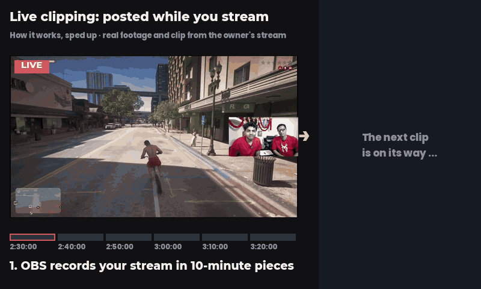
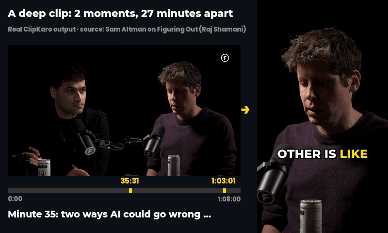
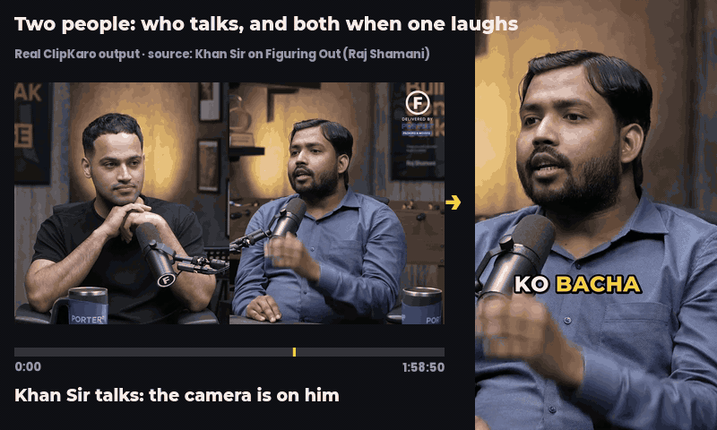
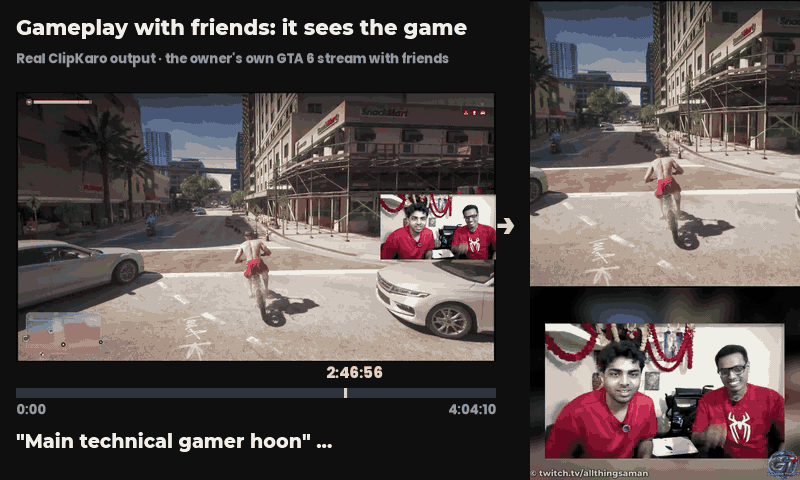
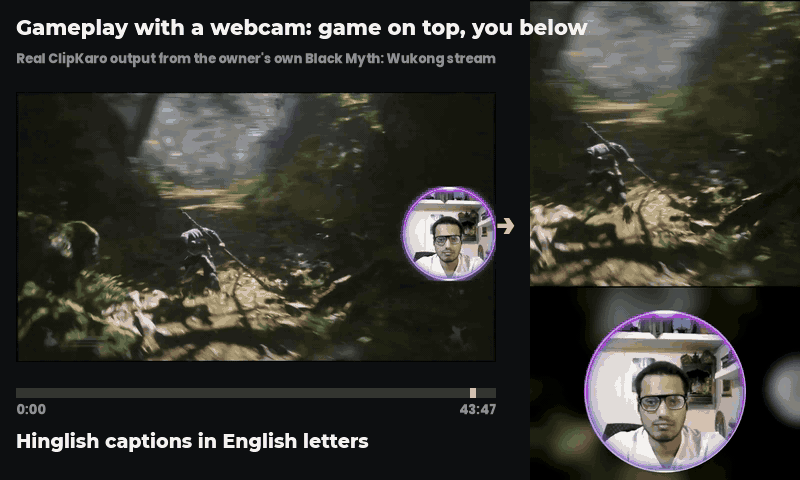
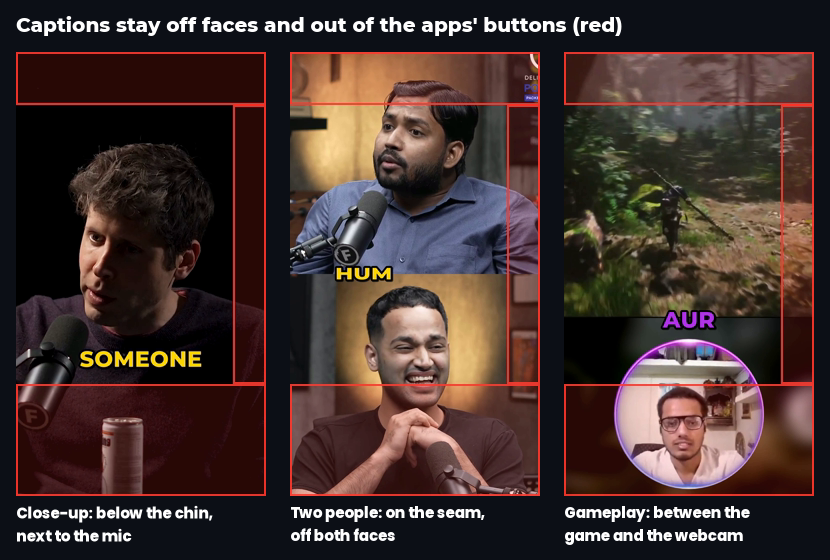

<p align="center">
  
</p>

# ClipKaro ✂️

[](LICENSE)
[](docs/requirements.md)
[](docs/installation.md)

**Turn a long video into short videos, ready to post.** Give it a YouTube link or a video file.
ClipKaro finds the best moments and makes standing (9:16) videos for **YouTube Shorts, Instagram
Reels and TikTok**: framed on whoever is talking, with captions that appear word by word. It's free,
it runs on your own computer, and it works just as well for **Hindi and Hinglish** as for English.

<p align="center">
  <a href="https://youtu.be/Dlq4z26w1QM"></a>
</p>
<p align="center"><b>▶ <a href="https://youtu.be/Dlq4z26w1QM">Watch the video guide</a></b> (16 min): how to install ClipKaro and
<a href="https://github.com/allthingsaman/PostKaro">PostKaro</a> on Windows and use them yourself.</p>

*"Clip karo" is Hinglish for "clip it".*

```
you:  clip this video: https://youtu.be/...
      → listens to the video → picks the best moments → cuts them standing (9:16) → edits them
      → output/<video>/edited/01-why-hard-work-isnt-enough.mp4  (+ a caption to post with each one)
```

> **New to all this?** Start with the **[user guide](docs/user-guide.md)**: simple steps, no coding
> needed.

## The best of ClipKaro

### 🔴 Live clipping: clips posted while you stream

<p align="center">
  
</p>
<p align="center"><sub>How it works, sped up. The footage and the clip are real ClipKaro output from the owner's GTA 6 stream.</sub></p>

Made for game launches, where the first clips get the views. OBS records your stream in 10-minute
pieces; every 10 minutes Claude clips the finished ones, and PostKaro posts them to YouTube Shorts,
Instagram Reels and your Facebook Page, **about 15-30 minutes after the moment**.
- **Your own OBS recording**, never a download: full quality, with your cam in it. Twitch chat and the
  clips viewers make only hint where people reacted.
- **Your stream stays smooth.** ClipKaro works at low priority and leaves the graphics card to OBS.
- **No review step.** Clips go out at once, and one that fails the quality check is never posted. For a
  test stream, `"live_post": "dry"` only shows what it would post.
- **What you need:** OBS, [PostKaro](https://github.com/allthingsaman/PostKaro) with your accounts
  connected, and Claude Code left open. About 150-250k Claude tokens per hour of stream: comfortable on
  Max, a few hours on Pro.
- **Start and stop.** Say **"start live clipping gta6"**, and **"the stream is over"** when you end.

**Set it up:** [docs/live-clipping.md](docs/live-clipping.md) (OBS settings, Twitch keys, a test stream,
going live). Streaming to YouTube, Twitch and Kick at once: [docs/streaming-setup.md](docs/streaming-setup.md).
Posting: [docs/postkaro.md](docs/postkaro.md).

### 🧵 Deep clips: one story from moments far apart

<p align="center">
  
</p>
<p align="center"><sub><b>Real ClipKaro output, not a mock-up.</b> Left: the real video, and where each moment sits in it.
Right: the short ClipKaro made. Footage: Sam Altman on <i>Figuring Out</i> with Raj Shamani (YouTube), shown as a demo.</sub></p>

Ask for them on a long podcast ("deep clip this"). The question at minute 8 and its answer at minute
52, or a point and the moment that proves it, become **one short**, in the order they were said, with
a white flash where it jumps. Three AI judges check that no join changes what anyone
meant, and a deep clip is only kept when it scores at least as well as the best single stretch around it.

### 🎙️ Two people: the one talking, and both when it matters

<p align="center">
  
</p>
<p align="center"><sub>Real output. Footage: Khan Sir on <i>Figuring Out</i> with Raj Shamani (YouTube), shown as a demo.</sub></p>

It listens to who is talking and shows that person. When someone laughs, both talk at once or the
talk goes quickly back and forth, it shows **both**, stacked, with the captions on the seam.

### 🎮 Gameplay with friends, done by itself

<p align="center">
  
</p>
<p align="center"><sub>Real output from the owner's own GTA 6 stream with friends on voice chat (Twitch). ClipKaro saw the
fall in the picture; the mumbled words after it get no caption rather than a wrong one.</sub></p>

A long stream where you and your friends play and talk on voice chat needs nothing but the link:
- **It watches the game, not just the words.** A clip starts at the crash or the fall, not at the shout
  after it, and a quiet second where something happens on screen stays in.
- **Careful listening.** On noisy Hinglish streams two more speech models check every caption word (with
  an NVIDIA card); words nobody can make out get no caption.
- **Your friends count like you.** Their banter and roasts become clips, with captions; the game
  characters' lines get none (the game shows its own).
- **Sound effects included** and on time, lots of clips when you ask ("no limit"), a "© twitch.tv/name"
  credit, and an email address or phone number said on stream cut out.

Podcasts and talks aren't touched by any of this.

### 🕹️ Gameplay with a webcam: the game on top, you below

<p align="center">
  
</p>
<p align="center"><sub>Real output from the owner's own Black Myth: Wukong stream.</sub></p>

It notices a webcam overlay by itself: **the game on top, you below**, the captions in between. It
sees that a video was a live stream, leaves out "Starting soon", "Be right back" and the ending
screen, and builds clips around **your** commentary and reactions, not the game characters' lines.
Game characters' lines get **no captions** (the game shows its own subtitles, so they'd appear twice);
their sound stays, and a great game scene can still be in a clip.

### 💬 Captions that stay off faces and out of the apps' buttons

<p align="center">
  
</p>

Captions keep out of the like and share buttons and the apps' top and bottom texts, and move to a
free line when they would cover a face or a chin. Made-up words (Whisper inventing text during a laugh
or game music) get no caption at all. Before cutting, Claude reads every clip's captions like a viewer
and fixes clear mishearings ("sorry" heard as "saari", a wrong name) *(standard and deep mode; quick
mode skips it)*.

### 🧐 A blind second opinion on every clip

Claude picks about twice as many ideas as you need. Then an AI critic, who never sees the titles or the
first scores, judges every idea three times, ranks them, and says what to fix: a slow start, an
unfinished ending, seconds nobody needs. Clips with a note get repaired before you see them. A real
report, from the podcast above:
```
 1. 7.4/10 Strong   45:47-46:19 + 46:29-46:58 + 47:10-47:21 (72 s)  "What Sam Altman Misses Most"
    hook 4.0 "'what version of you has died' is a striking opener" · payoff 4.0 "a strong, human landing"
 2. 7.2/10 Strong   56:48-57:49 (61 s)  "Almost All Startup Advice Is Terrible"
    hook 4.0 "answered 'almost all the advice is terrible'" · payoff 4.0 "ironic landing"
```

### 🇮🇳 Hindi and Hinglish, for real

Found by itself. Captions in English letters ("aaj hum business ki baat karenge") or in Hindi
letters, spelled the way people write Hinglish online. With an NVIDIA card, a **speech model trained
on Hinglish** writes the words down: on public tests it got half as many words wrong as before, and
its text costs Claude about 40 % fewer tokens to read. Skipped words are heard again,
so a line isn't lost to one stretched "word".

### 👂 It hears what the words can't show

Some of the best moments live in **how** something is said or shown. Claude reads short notes next to
the words: `[laughter ~2 s]`, `[voice raised]`, `[shouting]`, `[explosion]`, `[big action on screen]`,
and in gameplay `(other voice)` on lines spoken by a game character, not the streamer, and a line of
its own for big action where nobody talks. They show where to look; the words decide. A recording with your microphone on its own track (OBS can do that) is
written down from your voice alone.

### ✂️ A clean, tight edit, every time

Zoom-ins on the beat, captions that pop in word by word in a colour that fits the video, a couple of
soft whooshes, emojis on a few strong words (say "no emojis" to skip them), pauses and "um"s cut out,
and the volume set right for phones without crackling peaks. Every clip is checked by code before you
see it. Six caption looks: classic by default, or say "box", "karaoke", "minimal", "bold" or "comic
captions". "Hook title" adds a big title for the first seconds.

### And more
- 🔢 **The right number of clips.** Every good moment: 3 to 8, more for long videos, or "at least 10" /
  "at most 5". 💾 The good moments that weren't cut stay saved: "3 more clips from that video" later.
- 🏷️ **Your brand, and credit to the source.** Put your logo and a 3-5 s outro in the `brand` folder:
  the logo goes in the bottom-right corner of every clip, the outro at the end. Clips from a YouTube
  link get a small "© Channel name" in the bottom-left corner, Twitch videos "© twitch.tv/name"
  (`"source_credit": false` turns it off).
- 🔥 **Nothing held back.** The moments people are afraid to say out loud go viral, so ClipKaro keeps
  them and ranks them higher: a rant, a roast, a blunt verdict, gaali said with real feeling, taboo talk,
  an A-rated moment. Nothing is bleeped; captions and titles write rude words with stars ("F******").
  `"bold_clips": "neutral"` and `"star_words": false` turn that off.
- ⚡ **Three modes** to match your Claude plan: Quick, Standard and Deep ([see below](#three-modes-quick-standard-and-deep)).
- 📤 **Posting.** With **PostKaro** (a separate app) the clips go to YouTube Shorts, Instagram Reels and
  your Facebook Page, each with its own text, from your own laptop.
- 🔒 **Free and private.** No extra accounts, keys or subscriptions for ClipKaro, nothing uploaded.
  Fast with an NVIDIA graphics card (a 7-minute Hinglish video is written down in about a minute).

## Which AI helper do you need?
ClipKaro is driven by an **AI coding agent**: an AI helper that can work on your computer (run its
programs, read and write its files). The AI is the editor that picks the moments; ClipKaro's own
programs do the downloading, cutting and editing. It was built with **Claude Code**, but it doesn't
depend on it: any agent that can work on your computer can drive it.

| AI helper | Cost | Does it work? |
|---|---|---|
| **Claude Code** (what ClipKaro is made with) | a Claude plan that includes Claude Code (Pro or higher) | ✅ best: every feature, helpers working at the same time |
| **Google Antigravity** | has a **free plan** (weekly limits, which Google changes now and then) | ✅ the free limits are usually enough for about one video per session |
| Codex, Cursor, Gemini CLI, GitHub Copilot and other agents that read [AGENTS.md](AGENTS.md) | their own plans | ✅ they follow the same steps (helpers may run one after another) |
| **Claude's free plan** (the chat on claude.ai or the Claude app) | free | ❌ the chat can't reach your computer, so it can't run ClipKaro's programs |

Short on usage? Say **"quick clip this"** (basic mode): it uses about half of the default.
How much a video uses, measured on real runs, and whether it fits a small creator's plan:
[How much Claude usage](docs/requirements.md#how-much-claude-usage).

## ClipKaro or Opus Clip inside Claude?
Opus Clip, the best-known AI clipper, can also be used from inside Claude (a "connector"). It looks
the same from the outside, since you ask Claude for clips either way, but it works very differently:
- **With the Opus Clip connector, Opus Clip makes the clips** on its own servers. Claude only sends
  the link and brings the clips back, so you get the same clips as on Opus Clip's website.
- **With ClipKaro, your AI helper is the editor.** It reads every word of the video and chooses the
  moments, and ClipKaro's own programs cut and edit them on your computer.

| | Opus Clip inside Claude | ClipKaro |
|---|---|---|
| **Who picks the moments** | Opus Clip's own AI | your AI helper, reading every word; a second, blind AI critic checks every idea |
| **What you pay** | your Claude plan **plus** a paid Opus Clip plan (Pro or higher), and Opus Clip credits for every video (at least 10 per video) | your AI helper's plan only |
| **Limits** | 15 hours of video a month, at most 4 videos at a time | only your AI plan's usage limits |
| **Hindi and Hinglish** | ❌ Opus Clip says it doesn't support Hindi | ✅ a Hinglish speech model; captions in English letters |
| **Gameplay and live streams** | basic (reviews call it weaker on gaming) | ✅ webcam under the game, no captions for game characters, "Starting soon" screens left out |
| **Deep clips** (a question and its answer far apart, joined into one story) | ❌ | ✅ |
| **B-roll, following people who move** | ✅ | not yet |
| **Your logo and outro** | ✅ | ✅ from the `brand` folder |
| **Editing by hand** | ✅ a timeline editor | in words ("start clip 2 at 1:05", "'bow' should be 'boat'") |
| **Where your video goes** | uploaded to Opus Clip | stays on your computer |

**In short:** for Hindi, Hinglish and gaming, ClipKaro is the clear choice, and it costs nothing on top
of your AI plan. Opus Clip is more polished for English talking videos (B-roll, a hand editor). Which
one picks better moments on English podcasts hasn't been tested side by side yet.

<sub>Opus Clip's facts are from its own help pages, checked in November 2026 (they may change):
[the Claude connector](https://help.opus.pro/api-reference/claude-connector) and
[Hindi](https://help.opus.pro/docs/article/does-opusclip-support-hindi). More: [ClipKaro compared with Opus Clip](docs/roadmap-v2.md).</sub>

## Three modes: Quick, Standard and Deep
ClipKaro uses your AI helper's plan (Claude Code, Antigravity ...) to choose the best moments. The three
modes only change **how carefully the moments are chosen**, and so how much of your plan a video uses. Everything else is
the same in every mode: the framing, the captions, the edit, Hinglish, gameplay and the posting texts.

| | ⚡ **Quick** (basic) | ⭐ **Standard** (the default) | 🧵 **Deep** (advanced) |
|---|---|---|---|
| **How you ask** | "quick clip this: (link)" or "basic mode" | just "clip this: (link)" | "deep clip this: (link)" or "advanced mode" |
| **Who reads the video** | Claude alone, once | Claude, plus helpers that read a long video in parts at the same time, so nothing in the middle is skimmed | same as Standard |
| **A second opinion** (a blind AI critic scores every idea 3 times; weak starts and endings are repaired) | no | yes | yes |
| **Caption check** (Claude fixes misheard words, like "sorry" written as "saari") | no | yes | yes |
| **Deep clips** (two moments far apart joined into one story, checked by 3 honesty judges) | no | no | yes |
| **How much of your Claude plan** (measured, for a 30-minute video) | about 0.3 million tokens | about 0.6 million | about 1.1 million |
| **How long it takes** | fastest | a few minutes more | the longest |
| **Best for** | short videos, many videos a day, saving your plan, a quick first look | most videos: the best clips without thinking about it | long podcasts and interviews (40 minutes or more) where a question and its answer are far apart |

Gameplay and live streams add about 0.15 million tokens for 30 minutes (the word check and the frame
sheets), in every mode. Times, usage per video length and plan advice:
[What computer you need](docs/requirements.md#how-long-it-takes).

**Which one is for you?**
- **Not sure? Use Standard.** Just say "clip this". It's the default for a reason.
- **On Claude's Pro plan and clipping a lot?** Use **Quick**, and look over the captions yourself
  before posting (Quick doesn't check them).
- **A long podcast with a great story spread across it?** Use **Deep**. For any video longer than 21
  minutes, ClipKaro asks you once whether you want deep clips too.
- Want one of them every time? Write "always use quick mode" (or deep) under "My preferences" at the
  end of [CLAUDE.md](CLAUDE.md), or tell Claude "add to my preferences: always use quick mode".

## How it works
1. **Listen**: it downloads the sound and writes down every word with its exact time.
2. **Pick**: the AI (Claude Code) reads the words and chooses the best moments. A long podcast is
   read in parts of about 20 minutes, all at once, so nothing in the middle gets skimmed.
3. **Captions**: for Hindi/Hinglish, it writes every Hindi word in English letters.
4. **Cut**: each moment is cut to a standing video, framed on the speaker's face.
5. **Edit**: zooms, captions and sound effects are added, and the volume is evened out.

The computer does the mechanical work; the AI only makes the choices an editor would make.
How it works inside: [docs/architecture.md](docs/architecture.md).

## Quick start

### 1. Check your computer
Any 64-bit Windows, Mac or Linux computer with **8 GB of memory (RAM)** can run it. An **NVIDIA
graphics card (4 GB or more)** is **strongly recommended**: with it a video takes minutes, without it
a video can take a couple of hours. Details: [docs/requirements.md](docs/requirements.md).

### 2. Install (once)

**The easy way: let Claude Code install it.** Open [Claude Code](https://claude.com/claude-code) in
the folder where you want ClipKaro (for example your home folder. On Windows, not Documents or Desktop when OneDrive backs them up: the videos and ClipKaro's own files (a few GB) would fill your OneDrive) and type:

> **install this repo: https://github.com/allthingsaman/ClipKaro**

Claude downloads ClipKaro, checks your computer, installs what's missing and finds out by itself
whether you have an NVIDIA graphics card (and sets it up if you do). Anything that needs your
computer's password, it gives you to run yourself. When it's done, **open Claude Code inside the
new `ClipKaro` folder** (step 3). Every step explained simply: [docs/user-guide.md](docs/user-guide.md).

Using **Google Antigravity** or another agent instead? Open the folder in it and type the same
sentence; it follows the same steps ([AGENTS.md](AGENTS.md)).

**Or install it yourself.** You need: an AI helper ([Claude Code](https://claude.com/claude-code), or
another one from [the table above](#which-ai-helper-do-you-need)), **Python 3.10-3.14**, **ffmpeg** and
**Node.js** (recommended).

**Windows** (in PowerShell; open a new window after the `winget` lines):
```powershell
winget install -e --id Python.Python.3.12
winget install -e --id Gyan.FFmpeg
winget install -e --id OpenJS.NodeJS.LTS
winget install -e --id Git.Git
git clone https://github.com/allthingsaman/ClipKaro.git
cd ClipKaro
python install.py
```

> [!IMPORTANT]
> **Windows: one more step for YouTube links, a cookies file (2 minutes, once).**
> YouTube sometimes stops a download with **"Sign in to confirm you're not a bot"**. On Windows,
> ClipKaro can't read your YouTube login from Chrome, Edge or Brave (Windows locks it, so
> `--cookies-from-browser` fails there with "Failed to decrypt with DPAPI"). Give ClipKaro your login as
> a **cookies file** instead:
> 1. In the browser where you're logged in to YouTube, add the extension **"Get cookies.txt LOCALLY"**.
> 2. Open youtube.com, click the extension and press **Export**. It saves `www.youtube.com_cookies.txt`
>    to your Downloads folder.
> 3. Move that file into the **ClipKaro folder** (next to `run.py`). Keep its name, or call it `cookies.txt`.
>
> That's all: ClipKaro uses it by itself, **only when YouTube asks**. Treat the file like a password:
> git never uploads it. When YouTube stops accepting it after a while, export it again and replace the
> file. More: [docs/troubleshooting.md](docs/troubleshooting.md#youtube-asks-you-to-sign-in).

**Mac** (with [Homebrew](https://brew.sh)):
```bash
brew install python@3.13 ffmpeg-full node git
git clone https://github.com/allthingsaman/ClipKaro.git
cd ClipKaro
python3.13 install.py
```
(`brew install python` now gives Python 3.15, which is too new for the speech engine, and Homebrew's plain
`ffmpeg` can't draw captions: `ffmpeg-full` can, and ClipKaro finds it by itself.)

**Linux** (Ubuntu/Debian shown; Fedora needs the full ffmpeg from RPM Fusion, see the guide):
```bash
sudo apt install python3 python3-venv python3-pip ffmpeg nodejs git
git clone https://github.com/allthingsaman/ClipKaro.git
cd ClipKaro
python3 install.py
```

`install.py` checks your computer, tells you the exact command for anything that's missing, finds an
NVIDIA graphics card by itself and sets it up, and puts everything else in a private `.venv`
folder inside ClipKaro. You can run it again any time. Full guide for every system:
[docs/installation.md](docs/installation.md).

### 3. Make clips
Open Claude Code **inside the ClipKaro folder** (terminal: `cd ClipKaro`, then `claude`; desktop
app or VS Code: open the `ClipKaro` folder). Claude only knows how to make clips when it's started
there. Then type:

> **clip this video: https://youtu.be/...**

or, for a file on your computer (put the path in quotes):

> **clip this video: "C:\Users\you\Videos\my podcast.mp4"**

Claude does the rest by itself and shows you a table of finished clips, each with a caption you can
copy when you post.

**On Windows, with a YouTube link?** Make the YouTube cookies file first ([the Windows note
above](#2-install-once)), or a video YouTube asks about can't be downloaded.

Using a different AI helper (Google Antigravity, Codex, Cursor, Copilot, Gemini CLI, ...)? Open the
ClipKaro folder in it and type the same sentence; it follows [AGENTS.md](AGENTS.md).

### For AI agents installing ClipKaro
If a user asked you to install this repo, follow these steps (details per system in
[docs/installation.md](docs/installation.md)):
1. Clone it where the user is working (or where they ask):
   `git clone https://github.com/allthingsaman/ClipKaro.git`. No git? Download
   `https://github.com/allthingsaman/ClipKaro/archive/refs/heads/main.zip` and unpack it as `ClipKaro`.
   On Windows, don't clone into a folder OneDrive backs up (often Documents and Desktop): use the home
   folder (`C:\Users\<you>\ClipKaro`).
2. Check the system: OS, `python --version` (3.10-3.14; 3.15 is too new for the speech engine; use
   `python3` on macOS/Linux), ffmpeg with **libx264** and **libass** (`ffmpeg -hide_banner -encoders`,
   `-filters`), `node --version` (20+ recommended), and `nvidia-smi` (an NVIDIA GPU?). On a Mac,
   Homebrew's `python` is 3.15 and its plain `ffmpeg` has no libass: install `python@3.13` and
   `ffmpeg-full` (`install.py` and `run.py` find ffmpeg-full by themselves) and run
   `python3.13 install.py`. On Windows, if `python` is 3.15, run `py -3.12 install.py`.
3. Install what's missing, using the commands in [docs/installation.md](docs/installation.md) for
   that system. **Don't run commands that need admin rights (`sudo`) yourself:** give the user the
   exact commands in one block and wait until they say they're done. On Windows, `winget` may show a
   permission prompt; programs it installs only appear on the PATH of new terminals, so if `python`
   or `ffmpeg` still isn't found, ask the user to restart Claude Code (or call the program by its full
   path). Watch for the traps: Fedora's default `ffmpeg-free` has no libx264 (use RPM Fusion's
   `ffmpeg`), and Ubuntu/Debian need `python3-venv`. If the PC has an NVIDIA card but `nvidia-smi`
   fails, the driver is missing: help the user install it (docs/installation.md) before step 4.
4. From inside the ClipKaro folder run `python install.py`. It detects an NVIDIA GPU by itself and
   then installs the GPU libraries and the speech models too. Run it again until every line is
   `[ok]` (interrupted downloads resume). Without an NVIDIA GPU, tell the user that clipping works
   but is slow on the CPU.
5. NVIDIA only: `python run.py gpu large-v3-turbo` must print `[ok] GPU ...`.
6. Report what was installed, then tell the user to **start Claude Code inside the ClipKaro folder**
   and type `clip this video: <link or file>`. A session started in another folder doesn't load
   ClipKaro's clipping skill (`.claude/skills/clip-video/`). **On Windows, also tell them to make the
   YouTube cookies file once** (the Windows note under "Install"): without it, a YouTube link can stop
   with "Sign in to confirm you're not a bot", and `--cookies-from-browser` can't read Chrome, Edge or
   Brave on Windows.
7. **PostKaro too?** (only if the user wants their clips posted for them): clone
   `https://github.com/allthingsaman/PostKaro.git` next to ClipKaro (not inside it) and run its
   `install.py` with the same Python. It sets PostKaro to start at login. Connecting the YouTube,
   Instagram and Facebook accounts is done by the user, once, with its `docs/connect-accounts.md`
   ([docs/postkaro.md](docs/postkaro.md) explains it all simply). Tell the user that PostKaro only
   opens with its own link (`python run.py open` in the PostKaro folder): the bare
   `http://127.0.0.1:8765` shows "Open PostKaro with its link".

## What you can ask for
Add your wishes to the same message, in normal words (English, Hindi or Hinglish):

- "quick clip this" / "basic mode" (uses the least of your Claude plan) · "deep clip this" / "advanced mode" · later: "3 more clips from that video"
- "clip this, but only the 3 best" · "at least 10 clips" · "clips under 30 seconds" · "only the parts about money" · "only the first hour"
- "show me the moments before you cut them" · "don't edit them, just cut"
- "no sound effects" · "no zooms" · "captions lower" · "bigger captions" · "not in capital letters"
- Caption looks: "box captions" · "karaoke captions" · "minimal captions" · "bold captions" · "comic captions" (classic otherwise)
- "hook title" (a big 3-6 word title for the first seconds; only when you ask) · "no emojis"
- "use #00E5FF as the caption colour" · "Hindi captions in Hindi letters"
- "it's a gameplay video" · "keep it wide (16:9)" · "landscape copy" (a wide copy next to the standing clip) · "the video is in English"
- After you see the clips: "clip 2 starts too early" · "make clip 1 shorter" · "use yellow captions"
- Podcasts: "in clip 4, show both of them when he laughs" · "show the whole picture when he holds up the box"

The full list, and what each one changes: [docs/usage.md](docs/usage.md).

**Your own lasting wishes** ("always 5 clips", "my videos are in English", "my brand colour is
#00E5FF"): write them under "My preferences" at the bottom of [CLAUDE.md](CLAUDE.md), or just tell
Claude "add to my preferences: ...". See the [user guide](docs/user-guide.md#saving-your-own-preferences).

## What you get
```
output/<video>/
    edited/01-title.mp4     the finished short videos: upload these
    edited/01-title.srt     the captions as a separate subtitle file
    clips/01-title.mp4      the cut videos without the edit (also fine to post)
    clips.json              the chosen moments, with the text to post on each platform
    post.json               the finished clips with their posting text, for PostKaro
    transcript/             everything that was said, with times
```

Want them posted for you? **[PostKaro](https://github.com/allthingsaman/PostKaro)**, ClipKaro's partner
app (a separate install, on Windows, Mac and Linux), posts them to YouTube Shorts, Instagram Reels and
your Facebook Page from your laptop, each at its own time. With PostKaro installed, Claude ends with a
"Post them" link that opens every clip ready to schedule. To install it, tell Claude "install PostKaro
too", or see [docs/installation.md](docs/installation.md#postkaro-the-posting-app-optional).

## Languages
| Language | How well |
|---|---|
| English | ✅ fully supported |
| Hindi and Hinglish (and spoken Urdu) | ✅ fully supported: captions in English letters or Hindi letters ([docs/hinglish.md](docs/hinglish.md)) |
| Spanish, French, German, Portuguese, Russian and others written in Latin or Cyrillic letters | 🟡 works, not fine-tuned yet |
| Other scripts (Bengali, Tamil, Arabic, Chinese, ...) | 🔧 the words are written down, but the captions need a font added |

Details: [docs/languages.md](docs/languages.md). Add a language: [docs/adding-a-language.md](docs/adding-a-language.md).

## NVIDIA graphics card
`install.py` finds an NVIDIA card by itself and sets it up: it puts NVIDIA's helper files inside
ClipKaro's own folder (you only need a recent NVIDIA driver, nothing else) and runs a quick test. You
can test it again any time with `python run.py gpu large-v3-turbo`. ClipKaro uses the card
automatically; if it ever fails, it tells you why and carries on without it (slower).
Without an NVIDIA card (including all Macs), everything runs on the processor (CPU): it works, but
it's slow and not recommended for long videos.

## Settings
Your defaults are in `settings.json`: the language (`auto`), the speech model (`auto`), whether to
use the graphics card (`auto`), how Hindi captions are written (`roman` = English letters, or
`devanagari` = Hindi letters), the gameplay layout (`auto`), whether to ask about deep clips (`ask`)
the most clips to make when you don't give a number (`20`), whether bold, honest takes count extra
(`bold_clips`, `boost`; nothing is ever censored), rude words written with stars in captions and
titles (`star_words`, on), and the "© Channel" credit on clips from a
YouTube link (`source_credit`, on). You can also just ask Claude to change them. Details: [docs/usage.md](docs/usage.md#5-your-defaults-settingsjson).

## Running it by hand (optional)
Every step is a plain command you can run yourself:
```bash
python run.py fetch "<link or file>"          # sound + written words
# write output/<project>/clips.json (format in docs/architecture.md)
python run.py romanize <project>              # Hindi/Hinglish: English-letter spellings for the captions
python run.py cut <project>                   # standing videos
python run.py edit <project>                  # the edit
python run.py find <project> "exact phrase"   # exact time of a phrase
```
All commands and options: [docs/usage.md](docs/usage.md#command-reference).

## If something goes wrong
| Problem | Fix |
|---|---|
| `ffmpeg not found` | install ffmpeg ([docs/installation.md](docs/installation.md)), then open a **new** window |
| `your ffmpeg has no libx264` | install the full ffmpeg (Fedora: from RPM Fusion) |
| `Sign in to confirm you're not a bot` | put your YouTube cookies in the ClipKaro folder as `cookies.txt` ([how](docs/troubleshooting.md#youtube-asks-you-to-sign-in)) and run it again; on Mac/Linux `--cookies-from-browser chrome` (or firefox / edge) works too |
| Wrong language detected | `python run.py fetch <link> --lang en --retranscribe` (or `--lang hinglish`) |
| Very slow / graphics card not used | `python run.py gpu` tells you why; `python install.py` sets up the card |

Or simply paste the error into Claude Code and ask it to fix it. More help: [docs/troubleshooting.md](docs/troubleshooting.md).

## Documentation
| | |
|---|---|
| [User guide](docs/user-guide.md) | **start here if you're new**: simple steps, no coding |
| [Installation](docs/installation.md) | setup on Windows, Mac and Linux, NVIDIA graphics cards, updating |
| [Requirements](docs/requirements.md) | what computer you need, and how long things take |
| [Usage](docs/usage.md) | what to type, all the options, the files you get, settings |
| [Languages](docs/languages.md) | which languages work and how well |
| [Hindi / Hinglish](docs/hinglish.md) | how Hindi videos and English-letter captions work |
| [Troubleshooting](docs/troubleshooting.md) | common problems and questions |
| [Architecture](docs/architecture.md) | how it works inside, and how it picks moments (for developers) |
| [Adding a language](docs/adding-a-language.md) | step by step, for developers |
| [Posting with PostKaro](docs/postkaro.md) | install, open, connect your accounts, default accounts, posting every day |
| [Live clipping](docs/live-clipping.md) | clips posted while you stream: how it works, the OBS setup, going live, cost |
| [Streaming setup](docs/streaming-setup.md) | multistream on OBS: YouTube, Twitch and Kick at once, encoder settings, checking you're live |
| [Roadmap](docs/roadmap-v3.md) | what's next, in order |
| [Compared with Opus Clip](docs/roadmap-v2.md) | how ClipKaro compares with Opus Clip today |
| [Changelog](CHANGELOG.md) | what's new in each version |

## Folder layout
```
.claude/skills/clip-video/   the instructions Claude follows to make clips
clipper/                     the program's steps: fetch, sound, voices, hints, motion, parts, topics, critic, deep, romanize, cut, reframe, director, speakers, frames, facecam, brand, brandkit, plan, edit, qa, sfx, find, gpu
remotion/                    an optional second way to draw the edit
assets/                      fonts, the face-finding model, sound effects
docs/                        documentation (docs/media: the README's demo pictures and the script that makes them)
CLAUDE.md                    rules for Claude + your own preferences
settings.json                your defaults
brand/                       your logo and outro (yours, never uploaded)
run.py / install.py          starts each step / the setup
output/                      your projects (never uploaded)
```

## Please clip fairly
Only clip and post videos you own or have permission to use. Respect other creators and each
platform's rules. Watch your clips once before posting: automatic captions are good, not perfect.
The small "© Channel name" credit ClipKaro adds is a courtesy to the creator, not permission.

The demo pictures above use a few seconds of public podcasts (Sam Altman and Khan Sir on *Figuring
Out* with Raj Shamani) only to show what the tool does, with credit; nothing is offered for download.
If you own one of them and want it replaced, open an issue and it will be swapped within a day.

## Contributing
Bug reports, fixes and new languages are welcome: [CONTRIBUTING.md](CONTRIBUTING.md).

## Credits
- Created and maintained by **Aman Upadhyay** ([@allthingsaman](https://github.com/allthingsaman)).
- Based on [Claude-Video-Clipper](https://github.com/Plextrang/Claude-Video-Clipper) (MIT).
- Fonts: [Montserrat](https://github.com/JulietaUla/Montserrat) and
  [Poppins](https://github.com/itfoundry/Poppins) (Hindi + English letters), SIL Open Font License 1.1.
- Face finding: [YuNet](https://github.com/opencv/opencv_zoo/tree/main/models/face_detection_yunet) (MIT).
- Pitch of the voice (the "voice raised" hint): [SwiftF0](https://github.com/lars76/swift-f0) (MIT).
- Who is talking, and laughter (podcasts): [sherpa-onnx](https://github.com/k2-fsa/sherpa-onnx) (Apache 2.0)
  running [pyannote segmentation 3.0](https://huggingface.co/pyannote/segmentation-3.0) (MIT),
  [3D-Speaker ERes2Net](https://github.com/modelscope/3D-Speaker) (Apache 2.0) and Google's
  [YAMNet](https://github.com/tensorflow/models/tree/master/research/audioset/yamnet) (Apache 2.0);
  the same voice model tells a streamer from the game's characters.
- Careful listening on noisy Hindi / Hinglish streams: [Trelis Research](https://huggingface.co/Trelis)'s
  Hinglish Whisper ([CTranslate2 build](https://huggingface.co/nikh360pro/capsbro-hinglish-ct2)) and
  [Oriserve](https://huggingface.co/Oriserve)'s Whisper-Hindi2Hinglish-Swift
  ([CTranslate2 build](https://huggingface.co/MSpider3/whisper-hindi2hinglish-swift-ct2)), both Apache 2.0.
- Starter sound effects: [Mixkit](https://mixkit.co/free-sound-effects/) (Mixkit Sound Effects Free License).
- Demo footage in the README: *Figuring Out* with Raj Shamani (YouTube), credited under each picture;
  the gameplay is the owner's own stream.
- Built on [yt-dlp](https://github.com/yt-dlp/yt-dlp), [faster-whisper](https://github.com/SYSTRAN/faster-whisper),
  OpenAI's [Whisper](https://github.com/openai/whisper) models, [OpenCV](https://opencv.org),
  [FFmpeg](https://ffmpeg.org) and, optionally, [Remotion](https://www.remotion.dev) (free for individuals and
  small companies; [larger companies need a Remotion license](https://www.remotion.dev/license)).
- Works with [Claude Code](https://claude.com/claude-code). ClipKaro is an independent project and
  isn't affiliated with Anthropic.

## License
[MIT](LICENSE) © 2026 Aman Upadhyay. Fonts, the face model and sound effects keep their own
licences; see [LICENSE](LICENSE).
