# Architecture: how ClipKaro works

This page explains how ClipKaro turns one long video into finished vertical shorts: which parts
exist, what each one does, which files they pass to each other, and how the "clipping brain"
decides what to cut and how to edit it.

If you only want to use ClipKaro, you don't need this page: see [usage.md](usage.md) or the simple
[user guide](user-guide.md).

## In simple words
1. ClipKaro **downloads the sound** of the video and **writes down every word** with its exact time.
2. **Claude reads all the words** like a video editor would, and **chooses the best moments**: ones
   that grab attention in the first seconds, make sense on their own, and end on a strong point.
3. The program **cuts those moments** out of the video, turns them into **standing videos**, and
   keeps the speaker's **face in the middle**.
4. It **adds the edit**: zoom effects, captions that appear word by word, a couple of soft whooshes,
   and even volume.

Claude makes the **choices**; the program does the **mechanical work**. They pass notes to each other
as small files in the project folder, which you can open and read.

**Words used on this page:**

| Word | Meaning |
|---|---|
| transcript | everything that was said, written down, with times |
| Whisper / speech model | the free AI model that turns speech into text |
| GPU | an NVIDIA graphics card, used to run Whisper much faster |
| ffmpeg | a free tool that cuts, converts and encodes video and sound |
| JSON | a simple text format for data, like `{"title": "My clip"}` |
| 9:16 | the standing video shape of phones (1080 x 1920 pixels) |
| VAD | "voice activity detection": finds where someone is speaking |
| render | draw the final video, frame by frame |

---

## 1. The big idea: an AI editor plus a toolbox

ClipKaro splits the work in two:

| Who | Does what | Where it lives |
|---|---|---|
| **The AI editor** (Claude Code, or another AI coding agent) | Judgment: reads the transcript, picks the best moments, writes titles, emphasis words and posting captions, writes Roman spellings for Hindi words, checks its own cuts | [`.claude/skills/clip-video/`](../.claude/skills/clip-video/SKILL.md) (instructions), [`CLAUDE.md`](../CLAUDE.md), [`AGENTS.md`](../AGENTS.md) |
| **The toolbox** (Python scripts in `clipper/`) | Everything mechanical: download, transcription, language detection, cutting, face tracking, zooms, captions, sound, rendering | [`clipper/`](../clipper/), started through [`run.py`](../run.py) |

The AI never touches video pixels, and the scripts never make taste decisions. They talk to each
other only through **files on disk** (JSON and text). That makes every step:

- **re-runnable**: run a step again and it picks up from the files the previous step left,
- **inspectable**: you can open any file and see exactly what was decided,
- **editable by hand**: you can write or change `clips.json` yourself and skip the AI entirely.

Everything runs on your computer. Nothing is uploaded; the only network traffic is downloading the
video (if you give a link) and, once, the speech models.

---

## 2. The pipeline at a glance

```mermaid
flowchart TD
    U["You: clip this video: link or file"] --> A["AI editor reads CLAUDE.md and the clip-video skill"]
    A --> F["run.py fetch"]
    F -->|"yt-dlp downloads the audio only"| AU["source/audio.m4a"]
    AU -->|"ffmpeg: 16 kHz mono wav"| LD["Language detection<br/>Whisper base, CPU"]
    LD --> TR["Transcription with word timestamps<br/>faster-whisper on NVIDIA GPU or CPU"]
    TR --> TX["transcript/words.json<br/>sentences.json, transcript.txt"]
    TX --> PICK["AI editor reads the whole transcript<br/>and picks the moments"]
    PICK --> CJ["clips.json"]
    CJ --> HQ{"Hindi or Hinglish?"}
    HQ -->|yes| RO["run.py romanize<br/>AI fills romanize.json"]
    HQ -->|no| CK
    RO --> CK["run.py cut --check<br/>AI fixes any bad boundaries"]
    CK --> CUT["run.py cut<br/>yt-dlp downloads the video, up to 1080p"]
    CUT --> RF["Shot detection, face detection<br/>9:16 reframe, fit or facecam layout"]
    RF --> TWO{"Two people too far apart<br/>for one crop?"}
    TWO -->|yes| DIR["Director: voices, laughter, speaker register<br/>speaker crop or split screen"]
    TWO -->|no| CL
    DIR --> CL["clips/NN-title.mp4 and .json"]
    CL --> ED["run.py edit"]
    ED --> PL["Edit plan: zooms, captions, sound cues"]
    PL --> RD["Render: OpenCV + ffmpeg/libass, or Remotion<br/>audio mix normalised to -14 LUFS"]
    RD --> OUT["edited/NN-title.mp4 and .srt"]
```



| Step | Command | Reads | Writes | Who decides |
|---|---|---|---|---|
| 1. Get the transcript | `run.py fetch <link or file>` | the video link or file | `project.json`, `source/`, `transcript/` | scripts |
| 2. Pick the moments | *(the AI editor)* | `transcript/transcript.txt` | `clips.json` | AI editor |
| 2b. Roman captions (Hindi/Hinglish only) | `run.py romanize <project>` | `clips.json`, `words.json` | `romanize.json` (the AI fills it) | AI editor |
| 3. Cut to vertical | `run.py cut <project>` | `clips.json`, `words.json`, the video | `clips/NN-title.mp4` + `.json` | scripts |
| 4. Caption colour (optional) | `run.py brand <project>` | the video | `brand.json` | AI editor or scripts |
| 5. Edit | `run.py edit <project>` | `clips/*.json`, `brand.json`, `romanize.json` | `edited/NN-title.mp4` + `.srt` | scripts |
| Helper | `run.py find <project> "phrase"` | `words.json` | nothing (prints times) | |
| Helper | `run.py frames <project>` | `clips.json`, the video | `frames/NN-title.jpg` (what the crop keeps) | the AI editor looks |
| 2a. Long videos | `run.py parts <project>`, readers, `run.py topics <project>` | `transcript/` | `parts/`, `topics.json`, `topics.txt`, `candidates.json`, `candidates.txt` | AI readers + scripts |
| Helper | `run.py gpu [model]` | nothing | nothing (prints the GPU test result) | |

`<project>` is the folder name inside `output/` that `fetch` prints, for example
`my-podcast-episode-12-dQw4w9WgXcQ`.

---

## 3. Components

### 3.1 Files in this repository

```
run.py                       the single entry point: runs clipper.<step> inside .venv
install.py                   one-time setup: checks tools, creates .venv, GPU libraries, models
settings.json                your defaults (language, model, device, captions, layout)
requirements.txt             Python packages
CLAUDE.md                    project instructions Claude Code loads automatically
AGENTS.md                    the same pointer for other AI coding agents
.claude/skills/clip-video/   the AI editor's instructions
    SKILL.md                     the end-to-end workflow
    references/picking-moments.md  how to choose a good short (the editorial rules)
    references/editing.md          how the edit works and which knobs exist
clipper/                     the toolbox (Python)
    fetch.py      step 1: download audio, detect the language, transcribe
    romanize.py   step 2b: Roman spellings for Hindi words in captions
    cut.py        step 3: snap ranges to words, download the video, cut, reframe
    reframe.py    shot detection, face detection, 16:9 -> 9:16 crops and the split-screen layout
    director.py   two people on screen: speaker crop or split screen, moment by moment
    speakers.py   who speaks when (voices), laughter, and the video's speaker register
    frames.py     picture sheets of what the crop keeps (checked by the AI editor)
    facecam.py    webcam-overlay detection and the stacked gameplay layout
    brand.py      caption accent colour (override or picked from the video)
    plan.py       the edit plan: camera zooms, caption groups, sound cues
    edit.py       renders the plan (python or Remotion engine) and mixes the audio
    sfx.py        scans assets/sfx/ and builds the sound-effect catalog
    find.py       word-accurate phrase search in the transcript
    parts.py      splits a long transcript into parts for careful reading
    topics.py     joins the part readers' answers: the topic map and the clip candidates
    gpu.py        NVIDIA GPU detection, CUDA libraries, GPU self-test
    models.py     Whisper model downloads from Hugging Face (with retry/resume)
    common.py     shared helpers: paths, settings, JSON, text, ffmpeg/ffprobe wrappers
remotion/                    optional second render engine (React + Remotion)
assets/
    fonts/        Montserrat ExtraBold (Latin, Cyrillic), Poppins ExtraBold (Latin + Devanagari)
    models/       YuNet face detector (ONNX)
    sfx/          whoosh and click sounds + catalog.json
docs/                        this documentation
output/                      your projects (never committed)
```

### 3.2 Outside tools and libraries

| Component | Used for | Where |
|---|---|---|
| [yt-dlp](https://github.com/yt-dlp/yt-dlp) | downloading the audio (fetch) and the video, max 1080p (cut) from YouTube and other sites | `fetch.ytdlp`, `cut.ensure_video` |
| [Node.js](https://nodejs.org) | JavaScript runtime yt-dlp uses to solve YouTube's player challenges (optional, recommended) | passed to yt-dlp as `--js-runtimes node` |
| [ffmpeg / ffprobe](https://ffmpeg.org) | probing, audio conversion, scene-cut detection, cropping/scaling, H.264 encoding (libx264), AAC audio, burning captions (libass), loudness normalisation | everywhere, via `common.ffmpeg` |
| [faster-whisper](https://github.com/SYSTRAN/faster-whisper) | speech recognition with word timestamps; runs OpenAI's Whisper models on [CTranslate2](https://github.com/OpenNMT/CTranslate2) | `fetch.py` |
| Silero VAD (inside faster-whisper, runs on onnxruntime) | finding where speech is, so silences are skipped and missed speech can be found again | `fetch.detect_language`, `fetch.fill_gaps` |
| Whisper models (Hugging Face) | `tiny` (GPU test), `base` (language detection), `small.en`/`small` (CPU), `large-v3-turbo` (GPU and Hindi) | `models.py`, cached in `~/.cache/huggingface/hub` |
| [huggingface_hub](https://github.com/huggingface/huggingface_hub) | downloading and caching the models; resumes broken downloads | `models.model_path` |
| NVIDIA cuBLAS, cuDNN, NVRTC (pip packages) | GPU transcription; installed inside `.venv` by `install.py` when it finds an NVIDIA card, no CUDA toolkit needed | `gpu.py`, `run.py` |
| [OpenCV](https://opencv.org) | reading frames, YuNet face detection, Hough circles (round webcams), per-frame zooms, k-means colour picking | `reframe.py`, `facecam.py`, `edit.py`, `brand.py` |
| [YuNet](https://github.com/opencv/opencv_zoo/tree/main/models/face_detection_yunet) | the face detector model (MIT licence) | `assets/models/` |
| [sherpa-onnx](https://github.com/k2-fsa/sherpa-onnx) (optional, Apache 2.0) | runs the voice models offline: who speaks when | `speakers.voices` |
| [pyannote segmentation 3.0](https://huggingface.co/pyannote/segmentation-3.0) (MIT) | finds where each voice speaks (ONNX copy from sherpa-onnx) | downloaded to `~/.cache/clipkaro/models` |
| [3D-Speaker ERes2Net](https://github.com/modelscope/3D-Speaker) (Apache 2.0, VoxCeleb) | the "voice print" model that tells two voices apart | downloaded to `~/.cache/clipkaro/models` |
| [YAMNet](https://github.com/tensorflow/models/tree/master/research/audioset/yamnet) (Apache 2.0), on onnxruntime | hears laughter (classes Laughter, Giggle, Snicker, Belly laugh, Chuckle) | `speakers.laughter` |
| numpy, soundfile | number crunching, reading audio | everywhere |
| [Remotion](https://www.remotion.dev) (optional) | an alternative renderer that draws the same plan with React/CSS | `remotion/`, `edit.render_remotion` |

---

## 4. The data: every file a project creates

Each video gets its own folder: `output/<project>/`.

```
output/<project>/
    project.json                 what the video is and how it was transcribed
    source/
        audio.m4a                downloaded audio (links only)
        audio16k.wav             16 kHz mono copy for Whisper
        video.mp4                downloaded video, up to 1080p (links only, made by cut)
    transcript/
        words.json               every word with its start/end time
        sentences.json           words grouped into sentence lines
        transcript.txt           the readable transcript the AI editor reads
    clips.json                   the AI editor's picks
    romanize.json                Roman spellings of Hindi words (Hindi/Hinglish only)
    brand.json                   caption colours
    clips/
        01-title.mp4             raw vertical cut (already postable)
        01-title.json            timing, words, shots, focus points for the edit
    speakers.json                the speaker register: each voice of the video and its side
    parts/                       long videos: part-NN.txt to read, part-NN.json answers, plan.json
    topics.json, topics.txt      the topic map (long videos)
    candidates.json, .txt        every reader's clip candidates with exact ranges (long videos)
    frames/01-title.jpg          picture sheets made by run.py frames
    edited/
        01-title.mp4             the finished short
        01-title.srt             captions as a subtitle file
    .work/                       temporary files (edit plans, caption files, masks, and
                                 signals-NN.json: voices and laughter measured for a clip)
```

For a **local file**, nothing is copied: `project.json` stores the path and `cut` reads the file
where it is.

### project.json
```json
{
  "source": "https://youtu.be/... or /path/to/file.mp4",
  "kind": "youtube | local",
  "title": "Video title", "channel": "Channel name", "duration": 460.0,
  "slug": "project-folder-name", "audio": "audio.m4a", "video": "/path/to/file.mp4",
  "width": 1920, "height": 1080,
  "language": "hinglish", "asr_model": "large-v3-turbo", "asr_device": "cuda",
  "facecam": false
}
```
`facecam` holds the detected webcam box (or `false`) after the first `cut`, so detection runs once.
For YouTube links, `fetch` also keeps what the video page says, when it has it: `description`
(up to 3,000 characters), `chapters` (the creator's own, `[{"start", "end", "title"}]`) and
`heatmap` (YouTube's "most replayed" curve, `[[start, end, value]]`). Reading in parts uses them as
hints. Running `fetch` again on an existing project refreshes them and keeps the transcript.

If you correct words in `transcript/words.json` by hand, rebuild the two files made from it
(`sentences.json` and `transcript.txt`) the same way `fetch` does (`fetch.write_transcript`), so
the AI reads the corrected words too.

### transcript/words.json
A list of words, each with its text, start and end time in seconds, and Whisper's confidence:
```json
[{"w": "आज", "s": 12.40, "e": 12.62, "p": 0.93}, {"w": "business", "s": 12.90, "e": 13.31, "p": 0.88}]
```

### transcript/transcript.txt
What the AI editor reads. A header, then one sentence per line with `[start-end]` times in seconds:
```
# My video title
# channel: Some Channel
# duration: 7:40.0
# language: hinglish  (Hindi in Devanagari, English words in Roman; ...)
# format: [start_seconds-end_seconds] text   (seconds are what clips.json uses)

[12.40-17.85] तो आज मैं आपको बताऊँगा कि content creation में लोग सबसे बड़ी गलती क्या करते हैं।
```

### clips.json (written by the AI editor)
```json
{
  "clips": [
    {
      "id": 1,
      "title": "Why Hard Work Isn't Enough",
      "hook": "Exact first line of the clip",
      "ranges": [[123.4, 171.9]],
      "score": 9,
      "hook_type": "contrarian",
      "why": "One sentence: why this works as a standalone short",
      "emphasis": ["broke", "ten", "million"],
      "caption": "Ready-to-post caption, 1-2 lines + 3-5 hashtags"
    }
  ]
}
```
`ranges` can hold 2-3 pairs to splice parts of the video together; they play in the listed order.

Two optional fields change the framing of a stretch (source seconds); they always win over the
automatic framing:
```json
"show_full": [[656.32, 674.26]],
"framing": [[3389.6, 3391.7, "split"], [120.5, 124.0, "left"]]
```
`show_full` shows the whole landscape frame over a blurred background. `framing` takes `left`,
`right`, `center`, a number from 0 (left edge) to 1 (right edge), `split` (both people stacked) or
`full` (the same as `show_full`).

### romanize.json (Hindi/Hinglish)
One entry per Hindi word in the picked clips, Devanagari → Roman: `{"आज": "aaj", "बात": "baat"}`.

### brand.json
```json
{"accent": "#FFD60A", "text": "#FFFFFF", "outline": "#000000", "source": "override | video-colours | default",
 "palette": ["#4B8AC9", "#BE8B1B"], "note": "why this colour"}
```

### clips/NN-title.json (written by cut, read by edit)
Clip-relative timings: `fps`, `duration`, `parts` (source ranges), `shots` (each with `t0`, `t1`,
`mode` = `crop | fit | split | vertical | facecam | horizontal`, the `focus` point, usually the face,
and `f0`, the exact frame where the shot begins), `splices` and `splice_frames` (where spliced
ranges join), `words` (times relative to the clip), `director` (the two-person framing chosen, in
source seconds), plus `id`, `title`, `hook`, `emphasis`, and `layout`/`caption_y` for the facecam
layout.

### .work/NN-title.plan.json (written by edit)
The full edit plan: camera keyframes, caption groups with per-word timings and emphasis flags,
caption style, brand colours, sound-effect cues and transitions. Both render engines draw this
same plan.

---

## 5. The clipping brain

"The brain" is two things working together: the AI editor's judgment, and a set of small,
deterministic rules in the scripts. Here is each decision, in the order it happens.

### 5.1 Language detection (`fetch.resolve_language`)
1. Silero VAD cuts the audio down to speech only.
2. Whisper's `base` model (on the CPU, a few seconds) guesses the language on up to **4 windows of
   30 s spread through the speech**, and the guesses are averaged. One window can't tell Hinglish
   from English, four can.
3. If Hindi or Urdu comes out on top, **or** English is on top but Hindi + Urdu together reach
   **25 %**, the video is treated as **Hinglish**. Otherwise the top language is used.
4. You can always override it: `--lang hinglish`, `--lang en`, `--lang es`, ... or `"language"` in
   `settings.json`.

### 5.2 Model and device (`fetch.pick_model`, `gpu.pick_device`)
| Situation | Model |
|---|---|
| NVIDIA GPU available | `large-v3-turbo` (any language) |
| Hindi / Hinglish, no GPU | `large-v3-turbo` (much better Hindi; slow on CPU) |
| English, no GPU | `small.en` |
| Other languages, no GPU | `small` (multilingual) |
| `--model` / `"model"` set | exactly that model (`.en` is dropped for non-English videos) |

The device is the NVIDIA GPU when CTranslate2 can see one, else the CPU. If GPU transcription
fails it retries automatically: `cuda float16` → (only after an out-of-memory error)
`cuda int8_float16` → `cpu int8`, printing why. A failed model download stops instead, because no
other device would help.

### 5.3 Transcription (`fetch._transcribe_once`)
- **Long audio in pieces** (`split_points`): Whisper first turns all the audio it is given into one
  big table of sound features. For 3 hours that took about 7 GB of memory and crashed a 16 GB
  laptop. So audio longer than 30 minutes (`LONG_S`) is transcribed in pieces of at most 20 minutes
  (`PIECE_S`). Each cut lies in the longest pause within 90 s of the even split point, found with
  the voice detector (or, if there is no pause, at the quietest tenth of a second). Each piece gets
  the same settings and its own gap filling, and its word times are shifted back to the full
  video's time. Whisper reads 30 s windows, and in the last, shorter window of the audio it is
  given it makes up words and misplaces times (in a 3-hour test: junk words at one of 9 cuts; with
  only 10 s of overlap, a sentence lost 5 s before a cut). So each piece hears 45 s past its cut
  (`OVERLAP_S`, more than one window) and keeps only the words before the cut; the next piece starts
  right at the cut, in the pause. Memory then stays at about 3.5 GB for any length. Shorter audio is one piece, as
  before. Language detection on long audio listens to 4 stretches of 2.5 minutes instead of all of
  it, for the same reason.
- **Hindi / Hinglish**: decoded one 30 s window at a time (Devanagari needs 3-4x more tokens than
  English, and Whisper has a 448-token limit per window; sequential decoding resumes where a
  window stopped instead of dropping words), beam size 5, VAD on (Whisper invents text in silence),
  and for Hinglish a "hotwords" primer sentence written Hindi-in-Devanagari, English-in-Roman,
  so Whisper copies that style in every window.
- **Everything else**: faster-whisper's batched pipeline (about 2x faster on CPU), beam 1 on CPU
  and 5 on GPU.
- **Gap filling** (`fill_gaps`): Whisper sometimes skips a stretch of speech and stretches the
  previous word over it. ClipKaro finds speech (from VAD, split into pieces of at most 12 s) that no
  word covers for at least 1 s, transcribes just those pieces again (up to 2 rounds) and merges the
  recovered words in.
- **Clean-up** (`clean_words`): removes broken characters, a vowel sign looping inside a Hindi word,
  and the same word repeated 4+ times in a row.
- **Sentence lines** (`sentences`): words are grouped into lines at `.` `?` `!` `।` `॥`, at pauses
  over 0.8 s, at a comma once a line has 30 words, and at most every 60 words. So a line end is a
  real sentence end in most cases, which matters when the AI chooses where to cut.

### 5.4 Picking the moments (the AI editor)
The AI editor follows [`references/picking-moments.md`](../.claude/skills/clip-video/references/picking-moments.md):

- **Read the whole transcript first**, then choose. Long videos are read in parts (5.4a).
- **One self-contained idea** that a stranger understands with zero context.
- **Hook in the first 1-3 seconds**: the clip starts on the hook line itself. Six hook types:
  contrarian claim, a question viewers ask themselves, a surprising fact or number, a story opener,
  desire + obstacle, relatable situation + reframe. The hook's payoff must be inside the clip.
- **Story shape**: hook → contrast or stakes → explanation/proof/story → escalation → **payoff**.
  Never end mid-thought or on a weak "bridge" line.
- **Length**: 25-60 s is the sweet spot, hard limits 15-90 s.
- **Leave out**: warm-ups, references to things outside the clip, ads, sponsor reads, "like and
  subscribe", tangents, retakes.
- **Continuous ranges first**; splice 2-3 ranges only when it clearly makes a better short, with
  whole sentences, never building a sentence the speaker didn't say. Clips never overlap.
- **How many**: usually 3-8 per video (about one per 4-8 minutes of strong content). Quality over
  count.
- **Ranking** (score 1-10): hook strength > clear payoff > emotional energy > quotability > visual
  clarity. Best clip first.
- **Exact times**: when a hook starts or a payoff ends inside a transcript line, the AI looks up
  the exact word time with `run.py find`.
- **Gameplay videos**: clips are built around the creator's commentary and reactions, not the
  game characters' dialogue.
- **Never invent words**: a clip only contains what the speaker said.

It also writes for each clip: a 3-7 word title (used as the file name), 2-6 emphasis words that
stay highlighted in the captions, and a ready-to-post caption with hashtags.

### 5.4a Long videos: reading in parts, and the topic map (`parts.py`, `topics.py`)
A 2-hour transcript can't be read well in one go: the AI's file reader stops at 256 KB (Khan Sir's
transcript is 272 KB), and very long inputs get skimmed, especially in the middle.

1. **`run.py parts`** splits the transcript into parts when it's bigger than about 20,000 tokens
   (about 28 minutes of Hinglish). Each part has its own **stretch** of about 21 minutes plus 2
   minutes of context on each side, so a clip (90 s at most) never falls into a gap. Cuts go at the
   longest pause near the planned time, never inside a line. Each part file is checked to stay under
   20,000 estimated tokens (weights measured on Hinglish: 0.73 per Devanagari letter, 0.29 per Latin
   letter, 0.78 per digit, 0.28 per space or mark, 6 per line). A 2-hour video gives 6 parts.
   The file starts with the title, a cleaned description and the creator's chapters (when the
   video has them), and ends with the task (long data first, the question last).
2. **One reader per part, all at once** (the `clipkaro-part-reader` helper,
   `.claude/agents/clipkaro-part-reader.md`, following `references/reading-parts.md`). Each writes
   `parts/part-NN.json`: the topics that **start** in its stretch, the best moment of **every
   5-minute block** (so nothing is skimmed), and up to 5 clip candidates. A reader copies line times
   and quotes words; it never writes a time of its own (in research, models that wrote their own
   timestamps were about 4x less accurate).
3. **`run.py topics`** does the mechanics: it finds every quote in the transcript (exact, or at
   least 80% of the words in order), takes exact word times from there and stores the transcript's
   own words, joins the parts at their seams (a topic belongs to the part whose stretch holds its
   start; starts under 20 s apart become one), and checks everything: labels from closed lists, no
   gaps, quotes found, no candidate in an ad, teaser, intro or outro, signs of skimming. An error
   names the part whose reader must run again.
4. **The AI editor ranks all candidates together** from `candidates.txt` and copies their exact
   `ranges` into clips.json with `"from": "<candidate id>"`.

**The topic map** (`topics.json`, readable as `topics.txt`): topics of about 1-5 minutes in time
order, each with a title, a summary that says who claims what, a role (story, explanation,
argument, advice, debate, banter, reaction, digression, or structural: teaser, sponsor, intro,
outro, housekeeping), its opening words, 1-4 key lines with their own role (hook, question, claim,
example, setup, turn, punchline, conclusion, callback, reaction) and how they were said (own view,
quoting, hypothetical, sarcasm, impression, game), names in both scripts, energy, sensitive
subjects, back-references and open ends (questions or setups paid off later), plus two hints the
code adds: a peak of YouTube's "most replayed" curve, and lines the creator also used in the cold
open. These links are what deep clips (roadmap item 17) will build on.

**No extra model.** Topic boundaries come from the AI reading, not from an embedding model: in
published tests on spoken transcripts, asking a language model for a table of contents with quoted
opening lines beat embedding methods by a wide margin.

### 5.5 Checking the cut points (`cut.snap_range`, `cut.boundary_warnings`)
- Every range is **snapped to whole words**: it starts 0.12 s before the first word and ends
  0.30 s after the last one, without ever running into the neighbouring words.
- `cut --check` warns when a clip **starts or ends mid-sentence** (the previous or next word is
  less than 0.6 s away and there's no sentence end in between) or is **outside 15-90 s**. The AI
  editor then fixes the range or confirms the cut is intentional.

### 5.6 Reframing 16:9 to 9:16 (`reframe.py`)
1. **Shot detection**: ffmpeg's scene score on 320-px frames; a jump above 0.30 is a camera cut,
   and so is a jump above 0.08 that is at least 4x the median score of the 12 frames on each side
   (shots shorter than 0.8 s are merged). The second rule is for dark studios: against a black
   background real cuts score only 0.1-0.2 while still frames score about 0.001, and with the fixed
   0.30 alone a whole Sam Altman clip was one "shot" (the idea of PySceneDetect's adaptive
   detector). In bright videos it finds the same cuts.
2. **Face detection**: YuNet on 5 frames per shot (at 640 px); the largest face per frame; the
   **median** position over the frames, so a single bad detection can't move the crop. A shot
   needs a face in at least a third of its samples.
3. **Framing per shot**, held still for the whole shot (like a human editor, no jittery tracking):
   - `crop`: a 9:16 window centred on the face,
   - `fit`: no face (slides, screen recordings, b-roll): the whole frame over a blurred,
     darkened copy of itself, so no text gets cut off,
   - `vertical`: the source is already vertical; it's just scaled to fill,
   - a faceless shot shorter than 1 s (usually a missed detection) reuses the nearest face.
4. **Layout changes inside a shot** (an inserted photo or clip the cut detector missed): when the
   picture changes a lot *and* the main face is gone, the shot is split there (exact frame), so the
   insert gets its own framing. A split that changes nothing is joined back.
5. **People, not detections**: faces are grouped by position across the sampled frames. One person
   who leans or laughs can leave two groups; groups never seen in the same frame and less than about
   1.5 face-widths apart are joined. A second person must be seen *in the same frames* as the first.
   Two people who fit in one crop get a crop centred between them; two who don't are a
   **two-person shot**, framed by the director (5.6a).

### 5.6a Two people on screen: the director (`director.py`, `speakers.py`)
For podcasts and interviews where two people sit too far apart for one crop (a side-by-side
picture, or a wide shot of the room). It runs only on those stretches; all other shots are framed
exactly as above.

**Signals**, measured once per clip (cached in `.work/signals-NN.json`; raising `SIGNALS_V` in
`speakers.py` makes every cached clip measure again, so a fix reaches clips cut before it):
- **voices**: who speaks when (pyannote segmentation 3.0 + 3D-Speaker ERes2Net voice prints,
  clustered, run with sherpa-onnx on the clip's parts ±10 s);
- **laughter**: YAMNet laughter scores every 0.48 s;
- **mouth movement** of each face (only used summed up over many calm moments). Per side only the
  biggest face counts: small faces in wall art behind a guest never move, and measuring one of them
  once made a talking guest look silent, so every clip showed the listener.

**Speaker register** (`speakers.json`, one per video): voice prints are matched across all clips
(similarity ≥ 0.55 is the same person; a voice disturbed by laughter still counts when it clearly
resembles one person). Each clip votes on which side each person sits, using only *calm moments*
(one voice, real words, no laughter); the weighted median of all votes decides. One funny clip
can't flip it, because a laughing listener moves his mouth more than the talker.

**Rules**, moment by moment:
- one person talks, the other listens → crop on the speaker;
- a laugh (YAMNet ≥ 0.2), from 2 s before it (the punchline, when the listener starts to crack up)
  to 2 s after → both people (split screen);
- talking over each other, three or more short turns in a row (under 4 s each), or a voice it can't
  place → both people;
- a wide room shot → both people, unless one person talks alone for 6 s or more;
- silence keeps the framing around it.
Then: no framing shorter than 1.5 s (split screen 2 s), switches move to real gaps between words,
and a "word" longer than 0.8 s counts as stretched over a laugh. When unsure it always shows both:
that never shows the wrong face. A single-person reaction shot is left to the AI editor (it can
see a silent laugh on the `frames` sheet and add `framing`), because the sound alone can't tell who
laughs: in most laughs both people laugh.

**The split screen** (`mode: split`): two 9:8 boxes, one per person, stacked into 1080x1920; the
person who talks most in the clip on top, right above the captions on the seam (y = 960). In a
side-by-side picture each box stays inside its own half, so no strip of the other camera shows.

**Measured** on 9 hand-labelled Khan Sir clips (224 s of two-person shots): the ideal framing 83% of
the time, an acceptable one 91%, and a single wrong face 1%. If sherpa-onnx or the models are
missing, these shots keep the framing of 5.6.

### 5.7 Gameplay with a webcam overlay (`facecam.py`)
Detection runs once per video, on 24 frames spread across it. A webcam overlay is a face that:
- sits at the same spot (within 3 % of the frame width) in at least half of the frames,
- is small (no more than 20 % of the frame height),
- and is near a side (not in the middle 28-72 % of the width), which a presenter's face isn't.

A round cam is traced exactly (Hough circle) and drawn round; otherwise a 4:3 box about 3x the face
height is used. The layout: the middle of the gameplay on top (1080 x 1150, cropped to fill the
width), the cam enlarged below over a blurred copy of the game, and the captions on the seam.
Zooms are switched off in this layout. A fixed box in `settings.json` (`"facecam"`) overrides the
detection; `--layout crop` turns the layout off.

### 5.8 Zooms and camera moves (`plan.build_camera`)
- **Beats**: the framing changes at sentence ends and pauses over 0.45 s, at least 2.8 s apart
  (and at least every ~6 s). Camera cuts and splice points always get a change, because a framing
  change hides the jump. Long stretches without a sentence end change every ~4.5 s on a word start.
- **Levels**: beats alternate between wide (1.0, 1.04, 1.02) and punched-in (1.16, 1.22, 1.13,
  1.2), as hard cuts.
- **Opening**: starts at 1.18 and snaps out to wide in 9 frames (motion in the first second).
- **Emphasis**: 1 smooth "snap" zoom (2 if the clip is longer than 25 s), only after the first
  30 % of the clip, spaced apart.
- **Never dead**: a slow +0.03 push during every beat.
- All zooms **scale around the face** (the shot's focus point), so the face stays in place. A light
  motion blur is added only while a zoom moves fast, never on a camera cut.
- `fit` and `split` shots never zoom (they're there to show everything).
- A zoom change that goes with a camera cut lands on the exact frame where the cut shows (`f0`).

### 5.9 Captions (`plan.caption_groups`, `edit.write_ass`)
- Whisper's split tokens are merged back (`$500` + `,000`, `e` + `-commerce`, `100` + `%`).
- Groups of **1-3 words**, at most 15 characters and 1.6 s; a new group starts after a pause over
  0.35 s, at a sentence end and at a splice.
- Each word **pops in** as it's spoken (squashed to 60 % height, growing to full size in 110 ms),
  shown in the accent colour while spoken, then white; **emphasis words stay in the accent colour**.
- Font: **Montserrat ExtraBold**, UPPERCASE. If any word is in Devanagari the clip switches to
  **Poppins ExtraBold** in normal case (Devanagari has no capitals) without letter spacing (which
  would break Hindi letter shaping).
- Position: centre line at y = 1270 of 1920 (about two-thirds down), size 96 px, 8 px black
  outline, or on the seam in the facecam and split-screen layouts. A caption still on screen when
  the layout switches is cut in two on that exact frame, so it never covers a face. An `.srt` file
  with the same groups is written too.
- **Hindi/Hinglish**: `romanize.json` replaces each Hindi word with its Roman spelling before the
  groups are built. Word timings don't change.

### 5.10 Caption colour (`brand.py`)
1. `brand.json` if it exists (set with `run.py brand --accent "#RRGGBB"`, for example the
   creator's known brand colour).
2. Otherwise the colour is picked from the video: 24 frames, keep only saturated, bright pixels
   that aren't skin tones, k-means into up to 5 colours, score each by
   *pixel count x saturation^1.5 x brightness*, take the best and make it vivid enough to read.
3. If the video has almost no strong colour: the classic short-form yellow `#FFD60A`.

### 5.11 Sound (`sfx.py`, `plan.sfx_cues`, `edit.mix_audio`)
- Every file in `assets/sfx/` is scanned; its **role comes from its name** (`whoosh`/`swoosh`/
  `swish`/`swipe`, `hit`/`impact`/`boom`, `click`/`pop`/`tick`). A file holding several sounds is
  split at the silences, and each sound becomes a variant. The result is cached in `catalog.json`.
- **Cues** (`--sfx auto`, the default): one whoosh on the opening zoom (-15 dB) and one on the first
  emphasis zoom (-17 dB), each lined up so its loudest moment lands on the move. `--sfx light` keeps
  only the opening one, `--sfx none` none. `hit` and `click` sounds are catalogued for custom edits
  but not placed automatically.
- **Mix**: the voice gets a 70 Hz high-pass and gentle compression (2.5:1 from -20 dB); the effects
  are mixed under it; the result is loudness-normalised to **-14 LUFS** (true peak -1.5 dBTP), the
  level the big platforms play at.

### 5.12 Rendering and encoding (`edit.render_python`, `edit.render_remotion`)
- **python engine** (default): ffmpeg decodes the cut clip, OpenCV applies the camera (scale around
  the focus point) frame by frame, and ffmpeg burns in the captions with libass and encodes.
- **remotion engine** (`--engine remotion`): the same plan drawn by React/Remotion in a headless
  browser (slightly smoother text, much slower, needs Node.js and `install.py --remotion`).
- Output: 1080 x 1920, H.264 (libx264; CRF 17 for cuts, CRF 18 for edits), AAC 192 kbit/s 48 kHz,
  `+faststart` for quick playback online. The source frame rate is kept (24/25/30); 50/60 fps
  sources become 30.

---

## 6. GPU support (`gpu.py`, `run.py`)
- `gpu.cuda_device_count()` asks CTranslate2 how many NVIDIA GPUs it can use.
- `gpu.cuda_major()` reads which CUDA version the installed CTranslate2 was built for (12 today),
  and `install.py` (whenever it finds an NVIDIA GPU; `--cpu` skips this) installs the matching NVIDIA pip packages (`nvidia-cublas-cu12`,
  `nvidia-cudnn-cu12` (cuDNN 9), `nvidia-cuda-nvrtc-cu12`) into `.venv`. Only the NVIDIA **driver**
  is needed on the system; the CUDA toolkit is not.
- Finding the libraries: on Windows `gpu.enable_nvidia_libs()` adds them to the DLL search path; on
  Linux `run.py` puts `.venv/lib/python3*/site-packages/nvidia/*/lib` on `LD_LIBRARY_PATH` for the
  step it starts (the loader only reads it when a process starts), and `gpu.py` also preloads them.
- `run.py gpu [model]` runs a 5-second test transcription on the GPU and prints the result.
- Language detection always runs the small `base` model on the CPU (a few seconds); the
  transcription itself runs on the GPU.

---

## 7. Design rules worth keeping
1. **Judgment in the AI, mechanics in code.** Code never guesses what is interesting; the AI
   never edits pixels.
2. **Files are the interface.** Every step reads and writes plain JSON/text in the project folder.
   Steps can be re-run, repeated for single clips (`--clips 2`), or done by hand.
3. **One plan, two renderers.** `plan.py` decides everything; the renderers only draw it.
4. **Never invent words.** Clips contain only what was said; romanization changes spelling, not
   words or timings.
5. **Local and free.** No API keys, no uploads, no subscriptions.
6. **Fail loudly with the fix.** Every error message says what to do next.

## 8. Where to change things
| You want to change | Look at |
|---|---|
| How moments are picked | `.claude/skills/clip-video/references/picking-moments.md` |
| Zoom rhythm and levels | `clipper/plan.py`: `WIDE`, `PUNCH`, `DRIFT`, `OPEN_SCALE`, `beat_bounds` |
| Caption grouping | `clipper/plan.py`: `caption_groups` (`max_words`, `max_chars`, `max_dur`) |
| Caption look | `clipper/edit.py`: `write_ass`; `remotion/src/Clip.tsx` for the Remotion engine |
| Sound effects and when they play | `assets/sfx/` (drop files in), `clipper/plan.py`: `sfx_cues` |
| Fonts | `assets/fonts/` and `LATIN_FONT` / `HINDI_FONT` in `clipper/plan.py` |
| Languages | [adding-a-language.md](adding-a-language.md) |
| The facecam layout | `clipper/facecam.py`: `TOP_H`, `geometry` |
| Two-person framing rules | `clipper/director.py`: `HOLD`, `PRE`, `POST`, `LAUGH_ON`, `WIDE_SOLO`, `FLOOR` |
| How long videos are split | `clipper/parts.py`: `--minutes` (21), `--margin` (120 s), `TOKEN_CAP`, `SNAP_WINDOW` |
| What a part reader writes | `.claude/skills/clip-video/references/reading-parts.md`; the closed label lists in `clipper/topics.py` |
| How answers are checked and joined | `clipper/topics.py`: quote matching (`Transcript.find`, 80%), `MERGE_GAP`, the warnings |
| Voice and laughter models | `clipper/speakers.py`: `MODELS`, `VOICE_THRESHOLD`, `SAME_VOICE` |
| The split-screen layout | `clipper/reframe.py`: `split_box`; `clipper/cut.py`: `_framed` |
