# Architecture: how ClipKaro works

This page explains how ClipKaro turns one long video into finished vertical shorts: which parts
exist, what each one does, which files they pass to each other, and how the "clipping brain"
decides what to cut and how to edit it.

If you only want to use ClipKaro, you don't need this page: see [usage.md](usage.md) or the simple
[user guide](user-guide.md).

## In simple words
1. ClipKaro **downloads the sound** of the video and **writes down every word** with its exact time.
2. **Claude reads all the words** like a video editor would, and **chooses the best moments**: ones
   that grab attention in the first seconds, make sense on their own, and end on a strong point.
3. The program **cuts those moments** out of the video, turns them into **standing videos**, and
   keeps the speaker's **face in the middle**.
4. It **adds the edit**: zoom effects, captions that appear word by word, a couple of soft whooshes,
   and even volume.

Claude makes the **choices**; the program does the **mechanical work**. They pass notes to each other
as small files in the project folder, which you can open and read.

**Words used on this page:**

| Word | Meaning |
|---|---|
| transcript | everything that was said, written down, with times |
| Whisper / speech model | the free AI model that turns speech into text |
| GPU | an NVIDIA graphics card, used to run Whisper much faster |
| ffmpeg | a free tool that cuts, converts and encodes video and sound |
| JSON | a simple text format for data, like `{"title": "My clip"}` |
| 9:16 | the standing video shape of phones (1080 x 1920 pixels) |
| VAD | "voice activity detection": finds where someone is speaking |
| render | draw the final video, frame by frame |

---

## 1. The big idea: an AI editor plus a toolbox

ClipKaro splits the work in two:

| Who | Does what | Where it lives |
|---|---|---|
| **The AI editor** (Claude Code, or another AI coding agent) | Judgment: reads the transcript, picks the best moments, writes titles, emphasis words and posting captions, writes Roman spellings for Hindi words, checks its own cuts | [`.claude/skills/clip-video/`](../.claude/skills/clip-video/SKILL.md) (instructions), [`CLAUDE.md`](../CLAUDE.md), [`AGENTS.md`](../AGENTS.md) |
| **The toolbox** (Python scripts in `clipper/`) | Everything mechanical: download, transcription, language detection, cutting, face tracking, zooms, captions, sound, rendering | [`clipper/`](../clipper/), started through [`run.py`](../run.py) |

The AI never touches video pixels, and the scripts never make taste decisions. They talk to each
other only through **files on disk** (JSON and text). That makes every step:

- **re-runnable**: run a step again and it picks up from the files the previous step left,
- **inspectable**: you can open any file and see exactly what was decided,
- **editable by hand**: you can write or change `clips.json` yourself and skip the AI entirely.

Everything runs on your computer. Nothing is uploaded; the only network traffic is downloading the
video (if you give a link) and, once, the speech models.

---

## 2. The pipeline at a glance

```mermaid
flowchart TD
    U["You: clip this video: link or file"] --> A["AI editor reads CLAUDE.md and the clip-video skill"]
    A --> INF["run.py info: length, live stream?<br/>over 21 min: ask about deep clips"]
    INF --> F["run.py fetch"]
    F -->|"yt-dlp downloads the audio"| AU["source/audio.m4a"]
    F -.->|"and the video, in the background"| VID["source/video.mp4"]
    AU -->|"ffmpeg: 16 kHz mono wav"| LD["Language detection<br/>Whisper base, CPU"]
    LD --> TR["Transcription with word timestamps<br/>faster-whisper on NVIDIA GPU or CPU"]
    TR --> TX["transcript/words.json<br/>sentences.json, transcript.txt"]
    TX --> SND["Sound cues: laughter, applause,<br/>both talking at once, lively spots"]
    SND --> KIND["run.py kind: live stream? gameplay?<br/>break screens left out of the transcript"]
    VID -.-> KIND
    KIND --> PICK["AI editor reads the whole transcript (or readers, part by part)<br/>and writes about twice the clip ideas needed"]
    PICK --> CRI["run.py critic: 3 blind runs judge every idea<br/>gates + clip score; AI editor picks the best"]
    CRI --> CJ["clips.json"]
    CJ --> HQ{"Hindi or Hinglish?"}
    HQ -->|yes| RO["run.py romanize<br/>AI fills romanize.json"]
    HQ -->|no| CK
    RO --> CK["run.py cut --check<br/>AI fixes any bad boundaries"]
    CK --> CUT["run.py cut<br/>uses source/video.mp4 (downloads it if fetch didn't)"]
    CUT --> RF["Shot detection, face detection<br/>9:16 reframe, fit or facecam layout"]
    RF --> TWO{"Two people too far apart<br/>for one crop?"}
    TWO -->|yes| DIR["Director: voices, laughter, speaker register<br/>speaker crop or split screen"]
    TWO -->|no| CL
    DIR --> CL["clips/NN-title.mp4 and .json"]
    CL --> ED["run.py edit"]
    ED --> PL["Edit plan: zooms, captions, sound cues"]
    PL --> RD["Render: OpenCV + ffmpeg/libass, or Remotion<br/>audio mix normalised to -14 LUFS"]
    RD --> OUT["edited/NN-title.mp4 and .srt"]
```



| Step | Command | Reads | Writes | Who decides |
|---|---|---|---|---|
| 0. A quick look | `run.py info <link or file>` | the video page or file | nothing (prints length, live stream?, the deep-clip question) | scripts; the AI editor asks the user |
| 1. Get the transcript | `run.py fetch <link or file>` | the video link or file | `project.json`, `source/`, `transcript/` | scripts |
| 1c. Kind of video, break screens | `run.py kind <project>` (`fetch` runs it) | the video, `words.json`, `project.json` | `project.json` (`video_kind`, `breaks`, `facecam`), `breaks.jpg`, markers in `transcript.txt` | scripts |
| 1b. Sound cues | `run.py sound <project>` (`fetch` runs it) | `source/audio16k.wav`, `words.json` | `transcript/cues.json` | scripts |
| 2. Clip ideas | *(the AI editor)* | `transcript/transcript.txt` | a shortlist in `clips.json` (short videos) | AI editor |
| 2c. The critic | `run.py critic <project>`, 3 critic helpers, `run.py critic <project>` again | `clips.json` shortlist or `candidates.json` | `critic/`, `critic.txt`, `output/clip-log.csv`; then the final `clips.json` | AI critic + scripts + AI editor |
| 2b. Roman captions (Hindi/Hinglish only) | `run.py romanize <project>` | `clips.json`, `words.json` | `romanize.json` (the AI fills it) | AI editor |
| 3. Cut to vertical | `run.py cut <project>` | `clips.json`, `words.json`, the video | `clips/NN-title.mp4` + `.json` | scripts |
| 4. Caption colour (optional) | `run.py brand <project>` | the video | `brand.json` | AI editor or scripts |
| 5. Edit | `run.py edit <project>` | `clips/*.json`, `brand.json`, `romanize.json` | `edited/NN-title.mp4` + `.srt` | scripts |
| Helper | `run.py find <project> "phrase"` | `words.json` | nothing (prints times) | |
| More clips later | `run.py more <project>` (`--add N`, `--upto N`, `--pick 2,5`) | every `critic.json` round, `candidates.json`, `clips.json` (`spare`) | `more.txt`; with `--add`: new clips in `clips.json` | scripts + AI editor (posting text) |
| Helper | `run.py fixword <project> "wrong" "right"` | `words.json` | `words.json` (backup `words-before-fixes.json`), `sentences.json`, `transcript.txt` | AI editor or you |
| Helper | `run.py frames <project>` | `clips.json`, the video | `frames/NN-title.jpg` (what the crop keeps) | the AI editor looks |
| 2a. Long videos | `run.py parts <project>`, readers, `run.py topics <project>` | `transcript/` | `parts/`, `topics.json`, `topics.txt`, `candidates.json`, `candidates.txt` | AI readers + scripts |
| 2d. Deep clips (when the user said yes) | `run.py deep <project>` between helper steps, `run.py critic <project> --from deep`, `run.py honesty <project>` | `topics.json`, `transcript/`, `clips.json` | `deep/` (map, threads, candidates, critic, honesty, report) | AI helpers + scripts |
| Helper | `run.py gpu [model]` | nothing | nothing (prints the GPU test result) | |

`<project>` is the folder name inside `output/` that `fetch` prints, for example
`my-podcast-episode-12-dQw4w9WgXcQ`.

---

## 3. Components

### 3.1 Files in this repository

```
run.py                       the single entry point: runs clipper.<step> inside .venv
install.py                   one-time setup: checks tools, creates .venv, GPU libraries, models
settings.json                your defaults (language, model, device, captions, layout)
requirements.txt             Python packages
CLAUDE.md                    project instructions Claude Code loads automatically
AGENTS.md                    the same pointer for other AI coding agents
.claude/skills/clip-video/   the AI editor's instructions
    SKILL.md                     the end-to-end workflow
    references/picking-moments.md  how to choose a good short (the editorial rules)
    references/editing.md          how the edit works and which knobs exist
clipper/                     the toolbox (Python)
    fetch.py      step 1: download audio, detect the language, transcribe
    romanize.py   step 2b: Roman spellings for Hindi words in captions
    cut.py        step 3: snap ranges to words, download the video, cut, reframe
    reframe.py    shot detection, face detection, 16:9 -> 9:16 crops and the split-screen layout
    director.py   two people on screen: speaker crop or split screen, moment by moment
    speakers.py   who speaks when (voices), laughter, and the video's speaker register
    frames.py     picture sheets of what the crop keeps (checked by the AI editor)
    facecam.py    webcam-overlay detection and the stacked gameplay layout
    kind.py       what kind of video (live stream, gameplay) and its break screens
    info.py       a quick look at a link or file before anything is downloaded
    more.py       the good clip ideas not cut yet, and adding them as more clips later
    fixword.py    fixes a misheard caption word everywhere
    brand.py      caption accent colour (override or picked from the video)
    plan.py       the edit plan: camera zooms, caption groups, sound cues
    edit.py       renders the plan (python or Remotion engine) and mixes the audio
    brandkit.py   your logo and outro (the brand/ folder) and the "© Channel" credit to the source
    private.py    gameplay and streams: an email address or phone number said out loud (pieces said one right
                  after another, never everyday talk): hidden from the readers, cut out of clips
    watch.py      gameplay and streams: frame sheets for the readers, close-ups (zoom.py), events into clips (events.py)
    landscape.py  a 16:9 copy of finished clips: cut --landscape-copy (same timeline) + the standing edit's plan
                  redrawn for 1920x1080 (edit.write_ass with a frame size) + its sound
    subtitles.py  English gameplay: the game's own subtitles read on screen (rapidocr, English PP-OCRv5) -> game lines
    gameover.py   gameplay: game-over screens (WASTED, FAILED, BUSTED ...) read on the keyframes -> transcript lines
    compile.py    compilations across videos (advanced mode): moments.json -> frame sheets -> one built project
    reactions.py  silent reactions: faces' expressions (EmotiEffLib / HSEmotion) -> strong silent laughs and shocks:
                  picking hints (whole talk video at fetch) and split screens in two-person shots (cut.two_person)
    learn.py      learn from real views: PostKaro's numbers -> each clip's place on its channel -> report and the
                  critic's weights (gameplay / talk), slowly; critic.merge uses them
    studio.py     the review studio's helper (PostKaro's Studio page): one clip's facts as JSON; changes -> clips.json /
                  words.json -> cut, edit, qa (and the landscape copy) for that clip; one step of undo
    resolve.py    "export to resolve": a clip as Final Cut Pro 7 XML (pieces on V1/A1, sound effects on A2, pause-cut
                  markers) + captions.srt; DNxHR LB + PCM edit copies on Linux (the free Resolve can't read H.264/AAC)
    hearing.py    noisy Hindi / Hinglish streams: two more speech models and the word check (hear, rehear, wordcheck);
                  clips over ~29 s heard in windows of under 30 s; off while live clipping runs (CLIPKARO_LIVE)
    sfx.py        scans assets/sfx/ and builds the sound-effect catalog
    find.py       word-accurate phrase search in the transcript
    parts.py      splits a long transcript into parts for careful reading
    topics.py     joins the part readers' answers: the topic map, the clip candidates, focus reads
    sound.py      sound cues for the whole video: laughter, applause, both talking at once, game sound bursts, lively spots
    voices.py     who speaks each line: the main voice (the streamer, the guest) and up to two more
    hints.py      the notes next to the words Claude reads: a raised voice, shouting, game sounds, big action, other voices
    captions.py   the picked clips' captions as viewers will read them, for Claude's caption check
    motion.py     gameplay: where the game picture moves most (big action on screen)
    critic.py     the blind second opinion: critic packets, merging the runs, clip scores, hints
    deep.py       deep clips: the map for the thread finder, thread files, checks, the report
    honesty.py    deep clips: honesty packets for three judges, and merging their verdicts
    post.py       hands the finished clips to PostKaro: post.json, and PostKaro's link when installed
    gpu.py        NVIDIA GPU detection, CUDA libraries, GPU self-test
    models.py     Whisper model downloads from Hugging Face (with retry/resume)
    common.py     shared helpers: paths, settings, JSON, text, ffmpeg/ffprobe wrappers
remotion/                    optional second render engine (React + Remotion)
assets/
    fonts/        Montserrat ExtraBold (Latin, Cyrillic), Poppins ExtraBold (Latin + Devanagari)
    models/       YuNet face detector (ONNX)
    sfx/          whoosh and click sounds + catalog.json
docs/                        this documentation
output/                      your projects (never committed)
```

### 3.2 Outside tools and libraries

| Component | Used for | Where |
|---|---|---|
| [yt-dlp](https://github.com/yt-dlp/yt-dlp) | downloading the audio (fetch) and the video, max 1080p (cut) from YouTube and other sites. When YouTube asks for a sign-in check, `ytdlp` tries once more with the cookies file (`find_cookies_file`: setting `cookies_file`, else `*cookies*.txt` in the repo root) and keeps it in project.json (`cookies_file`) for the video download | `fetch.ytdlp`, `cut.ensure_video` |
| [Node.js](https://nodejs.org) | JavaScript runtime yt-dlp uses to solve YouTube's player challenges (optional, recommended) | passed to yt-dlp as `--js-runtimes node` |
| [ffmpeg / ffprobe](https://ffmpeg.org) | probing, audio conversion, scene-cut detection, cropping/scaling, H.264 encoding (libx264), AAC audio, burning captions (libass), loudness normalisation | everywhere, via `common.ffmpeg` |
| [faster-whisper](https://github.com/SYSTRAN/faster-whisper) | speech recognition with word timestamps; runs OpenAI's Whisper models on [CTranslate2](https://github.com/OpenNMT/CTranslate2) | `fetch.py` |
| Silero VAD (inside faster-whisper, runs on onnxruntime) | finding where speech is, so silences are skipped and missed speech can be found again | `fetch.detect_language`, `fetch.fill_gaps` |
| Whisper models (Hugging Face) | `tiny` (GPU test), `base` (language detection), `small.en`/`small` (CPU), `large-v3-turbo` (GPU and Hindi) | `models.py`, cached in `~/.cache/huggingface/hub` |
| [huggingface_hub](https://github.com/huggingface/huggingface_hub) | downloading and caching the models; resumes broken downloads | `models.model_path` |
| NVIDIA cuBLAS, cuDNN, NVRTC (pip packages) | GPU transcription; installed inside `.venv` by `install.py` when it finds an NVIDIA card, no CUDA toolkit needed | `gpu.py`, `run.py` |
| [OpenCV](https://opencv.org) | reading frames, YuNet face detection, Hough circles (round webcams), per-frame zooms, k-means colour picking | `reframe.py`, `facecam.py`, `edit.py`, `brand.py` |
| [YuNet](https://github.com/opencv/opencv_zoo/tree/main/models/face_detection_yunet) | the face detector model (MIT licence) | `assets/models/` |
| [sherpa-onnx](https://github.com/k2-fsa/sherpa-onnx) (optional, Apache 2.0) | runs the voice models offline: who speaks when | `speakers.voices` |
| [pyannote segmentation 3.0](https://huggingface.co/pyannote/segmentation-3.0) (MIT) | finds where each voice speaks (ONNX copy from sherpa-onnx) | downloaded to `~/.cache/clipkaro/models` |
| [3D-Speaker ERes2Net](https://github.com/modelscope/3D-Speaker) (Apache 2.0, VoxCeleb) | the "voice print" model that tells two voices apart | downloaded to `~/.cache/clipkaro/models` |
| [YAMNet](https://github.com/tensorflow/models/tree/master/research/audioset/yamnet) (Apache 2.0), on onnxruntime | hears laughter (classes Laughter, Giggle, Snicker, Belly laugh, Chuckle) | `speakers.laughter` |
| numpy, soundfile | number crunching, reading audio | everywhere |
| [Remotion](https://www.remotion.dev) (optional) | an alternative renderer that draws the same plan with React/CSS | `remotion/`, `edit.render_remotion` |

---

## 4. The data: every file a project creates

Each video gets its own folder: `output/<project>/`.

```
output/<project>/
    project.json                 what the video is and how it was transcribed
    source/
        audio.m4a                downloaded audio (links only)
        audio16k.wav             16 kHz mono copy for Whisper
        video.mp4                downloaded video, up to 1080p (links only; fetch downloads it in the background)
        video-download.log       what yt-dlp said while downloading it
    transcript/
        words.json               every word with its start/end time
        sentences.json           words grouped into sentence lines
        transcript.txt           the readable transcript the AI editor reads
        cues.json                sound cues: laughter, applause, both talking at once, game sound bursts, lively spots
        voices.json              the voice of each sentence line, and the main voice (run.py voices)
        hints.json               the lines in a raised voice or shouted (run.py hints)
        motion.json              gameplay: the moments of big action on screen
    breaks.jpg                   one picture of each break screen found (live streams)
    more.txt                     the good clip ideas not cut yet, best first (run.py more; post writes it too)
    clips.json                   the AI editor's picks (for a short video, first its shortlist)
    critic/                      the critic's packets (run-N.txt), answers (run-N.json), plan.json, critic.json
    critic.txt                   every clip idea ranked by clip score, with reasons and fix / check notes
    romanize.json                Roman spellings of Hindi words (Hindi/Hinglish only)
    brand.json                   caption colours
    clips/
        01-title.mp4             raw vertical cut (already postable)
        01-title.json            timing, words, shots, focus points for the edit
    speakers.json                the speaker register: each voice of the video and its side
    parts/                       long videos: part-NN.txt to read, part-NN.json answers, plan.json,
                                 focus-NN.txt/.json (a second look at a hinted moment)
    topics.json, topics.txt      the topic map (long videos)
    candidates.json, .txt        every reader's clip candidates with exact ranges (long videos)
    deep/                        deep clips (when the user said yes): map.txt, threads.json, thread-NN.txt/.json,
                                 candidates.json, critic/, honesty/ (packets and verdicts), honesty.json,
                                 report.txt, kept.json
    frames/01-title.jpg          picture sheets made by run.py frames
    edited/
        01-title.mp4             the finished short
        01-title.srt             captions as a subtitle file
    .work/                       temporary files (edit plans, caption files, masks, and
                                 signals-NN.json: voices and laughter measured for a clip)
```

For a **local file**, nothing is copied: `project.json` stores the path and `cut` reads the file
where it is. One file sits outside the project folders: `output/clip-log.csv`, one row per clip idea
the critic judged (its scores, cues and hints), to tune the critic later from what the user keeps.

### project.json
```json
{
  "source": "https://youtu.be/... or /path/to/file.mp4",
  "kind": "youtube | local",
  "title": "Video title", "channel": "Channel name", "duration": 460.0,
  "slug": "project-folder-name", "audio": "audio.m4a", "video": "/path/to/file.mp4",
  "width": 1920, "height": 1080,
  "language": "hinglish", "asr_model": "large-v3-turbo", "asr_device": "cuda",
  "facecam": false
}
```
`facecam` holds the detected webcam box (or `false`), so detection runs once (`kind` or the first `cut`).
`fetch` also keeps `live_status`, `was_live` and `categories` from YouTube. `run.py kind` adds
`video_kind` (`{"live", "gaming", "facecam", "why": [...]}`), `breaks` (`[{"n", "start", "end", "where":
"start" | "middle" | "end", "kept"}]`) and `break_scan` (what the scan looked at). `parts` adds `wish`:
the user's own clip numbers and deep-clip answer (`{"at_least", "at_most", "deep"}`).
For YouTube links, `fetch` also keeps what the video page says, when it has it: `description`
(up to 3,000 characters), `chapters` (the creator's own, `[{"start", "end", "title"}]`) and
`heatmap` (YouTube's "most replayed" curve, `[[start, end, value]]`). Reading in parts uses them as
hints. Running `fetch` again on an existing project refreshes them and keeps the transcript.

If you correct words in `transcript/words.json` by hand, rebuild the two files made from it
(`sentences.json` and `transcript.txt`) the same way `fetch` does (`fetch.write_transcript`), so
the AI reads the corrected words too.

### transcript/words.json
A list of words, each with its text, start and end time in seconds, and Whisper's confidence:
```json
[{"w": "आज", "s": 12.40, "e": 12.62, "p": 0.93}, {"w": "business", "s": 12.90, "e": 13.31, "p": 0.88}]
```

### transcript/transcript.txt
What the AI editor reads. A header, then one sentence per line with `[start-end]` times in seconds:
```
# My video title
# channel: Some Channel
# duration: 7:40.0
# language: hinglish  (Hindi in Devanagari, English words in Roman; ...)
# format: [start_seconds-end_seconds] text   (seconds are what clips.json uses)

[12.40-17.85] तो आज मैं आपको बताऊँगा कि content creation में लोग सबसे बड़ी गलती क्या करते हैं।
```

### clips.json (written by the AI editor)
```json
{
  "clips": [
    {
      "id": 1,
      "title": "Why Hard Work Isn't Enough",
      "hook": "Exact first line of the clip",
      "ranges": [[123.4, 171.9]],
      "score": 9,
      "hook_type": "contrarian",
      "why": "One sentence: why this works as a standalone short",
      "emphasis": ["broke", "ten", "million"],
      "caption": "Ready-to-post caption, 1-2 lines + 3-5 hashtags",
      "post": {
        "youtube": {"title": "Up to 100 characters", "description": "1-2 lines + up to 3 hashtags"},
        "instagram": {"caption": "Hook + question, at most 5 hashtags"},
        "facebook": {"caption": "1-2 lines, 0-3 hashtags"}
      }
    }
  ]
}
```
`caption` and `post` are the posting text (every clip has them); `run.py post` copies them into
`post.json` for PostKaro (section 5.13).

`ranges` can hold 2-3 pairs to splice parts of the video together; they play in the listed order.

Two optional fields change the framing of a stretch (source seconds); they always win over the
automatic framing:
```json
"show_full": [[656.32, 674.26]],
"framing": [[3389.6, 3391.7, "split"], [120.5, 124.0, "left"]]
```
`show_full` shows the whole landscape frame over a blurred background. `framing` takes `left`,
`right`, `center`, a number from 0 (left edge) to 1 (right edge), `split` (both people stacked) or
`full` (the same as `show_full`).

### romanize.json (Hindi/Hinglish)
One entry per Hindi word in the picked clips, Devanagari → Roman: `{"आज": "aaj", "बात": "baat"}`.

### brand.json
```json
{"accent": "#FFD60A", "text": "#FFFFFF", "outline": "#000000", "source": "override | video-colours | default",
 "palette": ["#4B8AC9", "#BE8B1B"], "note": "why this colour"}
```

### clips/NN-title.json (written by cut, read by edit)
Clip-relative timings: `fps`, `duration`, `parts` (source ranges), `shots` (each with `t0`, `t1`,
`mode` = `crop | fit | split | vertical | facecam | horizontal`, the `focus` point, usually the face,
and `f0`, the exact frame where the shot begins), `splices` and `splice_frames` (where spliced
ranges join), `words` (times relative to the clip), `director` (the two-person framing chosen, in
source seconds), plus `id`, `title`, `hook`, `emphasis`, and `layout`/`caption_y` for the facecam
layout.

### .work/NN-title.plan.json (written by edit)
The full edit plan: camera keyframes, caption groups with per-word timings and emphasis flags,
caption style, brand colours, sound-effect cues and transitions, and (v2.4) the source credit, the
logo and the outro (`credit`, `logo`, `outro`; the quality check leaves the outro out of its checks).
Both render engines draw this same plan.

---

## 5. The clipping brain

"The brain" is two things working together: the AI editor's judgment, and a set of small,
deterministic rules in the scripts. Here is each decision, in the order it happens.

### 5.1 Language detection (`fetch.resolve_language`)
1. Silero VAD cuts the audio down to speech only.
2. Whisper's `base` model (on the CPU, a few seconds) guesses the language on up to **4 windows of
   30 s spread through the speech**, and the guesses are averaged. One window can't tell Hinglish
   from English, four can.
3. If Hindi or Urdu comes out on top, **or** English is on top but Hindi + Urdu together reach
   **25 %**, the video is treated as **Hinglish**. Otherwise the top language is used.
4. You can always override it: `--lang hinglish`, `--lang en`, `--lang es`, ... or `"language"` in
   `settings.json`.

### 5.2 Model and device (`fetch.pick_model`, `gpu.pick_device`)
| Situation | Model |
|---|---|
| NVIDIA GPU available | `large-v3-turbo` (any language) |
| Hindi / Hinglish, no GPU | `large-v3-turbo` (much better Hindi; slow on CPU) |
| English, no GPU | `small.en` |
| Other languages, no GPU | `small` (multilingual) |
| `--model` / `"model"` set | exactly that model (`.en` is dropped for non-English videos) |

The device is the NVIDIA GPU when CTranslate2 can see one, else the CPU. If GPU transcription
fails it retries automatically: `cuda float16` → (only after an out-of-memory error)
`cuda int8_float16` → `cpu int8`, printing why. A failed model download stops instead, because no
other device would help.

### 5.3 Transcription (`fetch._transcribe_once`)
- **Long audio in pieces** (`split_points`): Whisper first turns all the audio it is given into one
  big table of sound features. For 3 hours that took about 7 GB of memory and crashed a 16 GB
  laptop. So audio longer than 30 minutes (`LONG_S`) is transcribed in pieces of at most 20 minutes
  (`PIECE_S`). Each cut lies in the longest pause within 90 s of the even split point, found with
  the voice detector (or, if there is no pause, at the quietest tenth of a second). Each piece gets
  the same settings and its own gap filling, and its word times are shifted back to the full
  video's time. Whisper reads 30 s windows, and in the last, shorter window of the audio it is
  given it makes up words and misplaces times (in a 3-hour test: junk words at one of 9 cuts; with
  only 10 s of overlap, a sentence lost 5 s before a cut). So each piece hears 45 s past its cut
  (`OVERLAP_S`, more than one window) and keeps only the words before the cut; the next piece starts
  right at the cut, in the pause. Memory then stays at about 3.5 GB for any length. Shorter audio is one piece, as
  before. Language detection on long audio listens to 4 stretches of 2.5 minutes instead of all of
  it, for the same reason.
- **Hindi / Hinglish**: decoded one 30 s window at a time (Devanagari needs 3-4x more tokens than
  English, and Whisper has a 448-token limit per window; sequential decoding resumes where a
  window stopped instead of dropping words), beam size 5, VAD on (Whisper invents text in silence),
  and for Hinglish a "hotwords" primer sentence written Hindi-in-Devanagari, English-in-Roman,
  so Whisper copies that style in every window.
- **Everything else**: faster-whisper's batched pipeline (about 2x faster on CPU), beam 1 on CPU
  and 5 on GPU.
- **Gap filling** (`fill_gaps`): Whisper sometimes skips a stretch of speech and stretches the
  previous word over it. ClipKaro finds speech (from VAD, split into pieces of at most 12 s) that no
  word covers for at least 1 s, transcribes just those pieces again (up to 2 rounds) and merges the
  recovered words in.
- **Clean-up** (`clean_words`): removes broken characters, a vowel sign looping inside a Hindi word,
  and the same word repeated 4+ times in a row.
- **Re-listening to unclear speech** (`unsure_stretches`, `relisten`): a run of 4+ words (1.5 s+)
  whose mean confidence is under 0.45 is heard again. Runs are found two ways and both are taken:
  the stretch whose confidence sums furthest below 0.45 (no pause of 1 s or more inside), so clear
  words next to it can't hide it, and the first version's word-by-word runs (good at short ones).
  Two runs with only a short, shaky bit between them (6 words, 2.5 s, mean under 0.75, e.g. a
  hallucinated "कर दो कर दो") become one, and unsure words right next to it join too. (The first
  version alone grew a run word by word and dropped all of it when the clear words after it pushed
  the mean over 0.45: a game character's English reply kept Devanagari-nonsense captions.) If
  Whisper's top language guess for it is English in a Hindi/Hinglish video (a game character, a film
  clip), it is decoded in English: only that stretch's audio (giving Whisper the whole video made it
  prepare all of it for every stretch: 18 minutes instead of 5 for an 83-minute stream), one fixed
  decode (temperature 0), and a thin answer is tried again with a tighter window, then as two halves
  (a window a few tenths of a second wider once gave only "Oh" for a 13 s line). New words stay
  between the kept neighbours, and an edge word that repeats its neighbour is dropped ("How am" +
  "am I"). The English replaces the nonsense when it is sure (0.6+, and 0.15 above before), with one
  check: forced into English, a streamer's own Hinglish comes back *translated* ("usko ghar jaana
  hai" -> "I have to go to his house"). So the stretch is also decoded as Hindi: English speech comes
  back in Roman letters there ("don't push me ..."), Hinglish in Devanagari ("इसको घर जाना है"). Mostly
  Devanagari and surer than the English means a translation: no English. That decode is never used
  for captions (it loops: "कर दो कर दो ..."; Whisper's 2.4 compression-ratio test drops loops).
  Everything not replaced is marked `unsure` and gets **no captions** (`cut --check` names the
  stretch; `transcript.txt` marks the line "(unclear …)"). Only English is accepted as a second
  language: in tests, Korean, Japanese and Chinese "recognitions" of game audio were loops and made-up
  text. Measured (Nov 2026): podcasts and talking videos have 0-24 such stretches (at most 0.6 % of
  their words: cross-talk and laughter heard as nonsense); a 44-minute gameplay video had 90 with the
  first version, of which 29 became correct English game lines ("…he may yet rise again"); an
  83-minute GTA stream has 93 now, of which 26 became English and 8 were caught as translations of
  the streamer's own Hinglish. `run.py relisten
  <project>` does the same for videos transcribed before (from `words-before-relisten.json`).
- **Tidy** (`tidy.tidy_words`, after the sound pass): words Whisper made up get `unsure` (no captions,
  times kept): shaky words (under 0.6) during a laugh found by the sound pass, laugh sounds written
  out ("ha ha", "हा हा"), the noise word "झाल", and loops (a phrase of 1-4 words 3+ times in a row)
  that are known made-up ones ("कर दो", "झाला है") or have a mean confidence under 0.6; of a phrase
  repeated 8+ times, everything after the first 3. Measured on 13 videos: English 0 words, podcasts up
  to 0.2 %, gameplay 1-1.4 %. Captions also drop "…" and a leading "..." (`plan.display`).
- **Sentence lines** (`sentences`): words are grouped into lines at `.` `?` `!` `।` `॥`, at pauses
  over 0.8 s, at a comma once a line has 30 words, and at most every 60 words. So a line end is a
  real sentence end in most cases, which matters when the AI chooses where to cut.

### 5.3a Keeping up with new speech models (`asrbench.py`)
No newer open Whisper than large-v3-turbo exists (Nov 2026); the 2026 releases (GPT-Realtime-Whisper,
ElevenLabs Scribe v2, Sarvam) are paid cloud services that would upload the audio. Open Hinglish
fine-tunes exist but only report their own numbers. So a model is chosen by a test on the owner's
own videos: `asr-bench make` cuts four ~3-minute snippets (anime narration, talking to the camera,
gameplay with an English game voice, an English podcast) and drafts a reference text from the current
transcript, which the owner corrects by ear once. `asr-bench run <model>` transcribes them the way
`fetch` does (re-listening included) and scores the share of words wrong. Words are compared by a
sound key (`sound_key`): Devanagari turned into simple Roman (`roman`), long vowels and aspiration
folded, doubled letters merged, so क्या, kya and kyaa are the same word and a model writing Roman
Hinglish is not punished. Only Hindi, Hinglish and English; only faster-whisper (CTranslate2) models.
A model is downloaded only when someone runs it.

### 5.4 Picking the moments (the AI editor)
The AI editor follows [`references/picking-moments.md`](../.claude/skills/clip-video/references/picking-moments.md):

- **Read the whole transcript first**, then choose. Long videos are read in parts (5.4a).
- **One self-contained idea** that a stranger understands with zero context.
- **Hook in the first 1-3 seconds**: the clip starts on the hook line itself. Six hook types:
  contrarian claim, a question viewers ask themselves, a surprising fact or number, a story opener,
  desire + obstacle, relatable situation + reframe. The hook's payoff must be inside the clip.
- **Story shape**: hook → contrast or stakes → explanation/proof/story → escalation → **payoff**.
  Never end mid-thought or on a weak "bridge" line.
- **Length**: 25-60 s is the sweet spot, hard limits 15-90 s.
- **Leave out**: warm-ups, references to things outside the clip, ads, sponsor reads, "like and
  subscribe", tangents, retakes.
- **Continuous ranges first**; splice 2-3 ranges only when it clearly makes a better short, with
  whole sentences, never building a sentence the speaker didn't say. Clips never overlap.
- **How many**: `parts` prints a range (`parts.clip_target`). A number the user asked for ("at least
  10", "at most 5", "give me 8") always wins. Otherwise every decent clip from 3 up to 8 (v1.1's range,
  `V11_MAX`) or about one per 7 minutes of real video (break screens don't count), whichever is more,
  at most `max_clips` (20); never padded. Each part reader is asked for about 2.5 ideas per clip at
  the top of the range, spread over the parts (5-10 per part), so the critic has enough to rank.
- **Ranking** (score 1-10): hook strength > clear payoff > emotional energy > quotability > visual
  clarity. Best clip first.
- **Exact times**: when a hook starts or a payoff ends inside a transcript line, the AI looks up
  the exact word time with `run.py find`.
- **Gameplay videos**: clips are built around the creator's commentary and reactions, not the
  game characters' dialogue.
- **Never invent words**: a clip only contains what the speaker said.

It also writes for each clip: a 3-7 word title (used as the file name), 2-6 emphasis words that
stay highlighted in the captions, and a ready-to-post caption with hashtags.

### 5.4-modes Quick, standard, deep
The mode only changes how the moments are picked; everything after (posting texts, captions, Roman
Hinglish, re-listening, break screens, cut, edit) is the same.
- **standard** (default): reader helpers for long videos (5.4a), the critic (5.4c), the repair round.
- **deep**: standard + the deep pass (5.4d), when the user asks or says yes to the question for
  videos over 21 minutes (`parts.DEEP_ASK_MIN`).
- **quick**: only when the user asks ("quick", "use fewer tokens"). `parts --mode quick` records it
  (`wish.mode`) and tells the AI editor to read the transcript, or the part files one at a time,
  itself and pick straight into the final clips.json: no helpers, no critic, no repair round, no deep
  pass. About v1.1's Claude usage; the long-video parts mean the middle isn't skimmed as in v1.1.

### 5.4a Long videos: reading in parts, and the topic map (`parts.py`, `topics.py`)
A 2-hour transcript can't be read well in one go: the AI's file reader stops at 256 KB (Khan Sir's
transcript is 272 KB), and very long inputs get skimmed, especially in the middle.

1. **`run.py parts`** splits the transcript into parts when it's bigger than about 20,000 tokens
   (about 28 minutes of Hinglish). Each part has its own **stretch** of about 21 minutes plus 2
   minutes of context on each side, so a clip (90 s at most) never falls into a gap. Cuts go at the
   longest pause near the planned time, never inside a line. Each part file is checked to stay under
   20,000 estimated tokens (weights measured on Hinglish: 0.73 per Devanagari letter, 0.29 per Latin
   letter, 0.78 per digit, 0.28 per space or mark, 6 per line). A 2-hour video gives 6 parts.
   The file starts with the title, a cleaned description and the creator's chapters (when the
   video has them), and ends with the task (long data first, the question last).
2. **One reader per part, all at once** (the `clipkaro-part-reader` helper,
   `.claude/agents/clipkaro-part-reader.md`, following `references/reading-parts.md`). Each writes
   `parts/part-NN.json`: the topics that **start** in its stretch, the best moment of **every
   5-minute block** (so nothing is skimmed), and up to 5 clip candidates. A reader copies line times
   and quotes words; it never writes a time of its own (in research, models that wrote their own
   timestamps were about 4x less accurate).
3. **`run.py topics`** does the mechanics: it finds every quote in the transcript (exact, or at
   least 80% of the words in order), takes exact word times from there and stores the transcript's
   own words, joins the parts at their seams (a topic belongs to the part whose stretch holds its
   start; starts under 20 s apart become one), and checks everything: labels from closed lists, no
   gaps, quotes found, no candidate in an ad, teaser, intro or outro, signs of skimming. An error
   names the part whose reader must run again.
4. **Focus reads.** If a line from the creator's own cold-open teaser comes back later in the
   video, or YouTube's "most replayed" curve has a strong peak, and no candidate covers it,
   `topics` writes a small `parts/focus-NN.txt` around it (90 s before to 60 s after) for one more
   reader (at most 3 per kind of hint). Its candidates (ids `f1-c1`, ...) must include the hinted
   line. A video without a teaser or a curve simply gets none.
5. **The critic judges all candidates** (5.4c) and the AI editor picks from its list.

**The topic map** (`topics.json`, readable as `topics.txt`): topics of about 1-5 minutes in time
order, each with a title, a summary that says who claims what, a role (story, explanation,
argument, advice, debate, banter, reaction, digression, or structural: teaser, sponsor, intro,
outro, housekeeping), its opening words, 1-4 key lines with their own role (hook, question, claim,
example, setup, turn, punchline, conclusion, callback, reaction) and how they were said (own view,
quoting, hypothetical, sarcasm, impression, game), names in both scripts, energy, sensitive
subjects, back-references and open ends (questions or setups paid off later), plus two hints the
code adds: a peak of YouTube's "most replayed" curve, and lines the creator also used in the cold
open. These links are what deep clips (roadmap item 17) will build on.

**No extra model.** Topic boundaries come from the AI reading, not from an embedding model: in
published tests on spoken transcripts, asking a language model for a table of contents with quoted
opening lines beat embedding methods by a wide margin.

### 5.4b Sound cues for every video (`sound.py`)
YouTube's "most replayed" curve only exists for popular videos (none of a small creator's videos,
and not even every interview with millions of views). So ClipKaro also listens to every video
itself, right after transcribing:
- **YAMNet** (the laughter model the director already uses) over the whole audio, read in 60 s
  blocks: laughter (a frame at least 0.30 sure and two frames in a row; the director's own rule is
  0.15), applause and cheering, music. Laughs and applause during music don't count (game sound,
  jingles).
- **pyannote segmentation 3.0** in 10 s windows: two people talking at once, and quick turn
  switches. Both models run on onnxruntime; no new download.
- **Loudness and talking speed** per 10 s, as z-scores within this one video (never compared
  between videos).
- **Lively spots:** the 30 s windows with the highest rank sum of laughter, both talking / turns,
  loudness and speed, each with at least one clear reason (about 10% of the video). They go into
  the part files and the `parts` output as places to check; a spot becomes a clip only if its
  words make one.
- **Markers** for the critic: `[laughter ~2 s]`, `[applause]`, `[both talk at once]`.

Cost: about 25 s for 2 hours (measured: 23 s and under 500 MB for the Khan Sir podcast; 36 s for 3
hours). Evidence: in recorded meetings, laughter was the strongest single cue for lively stretches,
then the words, then who talks when, then loudness and pitch (Makhervaks et al., ICASSP 2020). So
the words stay the main judge, and no cue ever lowers a clip.

### 5.4b-2 Hints next to the words (v2.3: `voices.py`, `hints.py`, `motion.py`)
Since v2.3 the lines Claude reads (`transcript.txt`, the part files, the critic's clip texts) carry
short notes at the end of a line, and `(other voice)` at its start:
`[12.40-15.10] (other voice) You call it whatever you want [explosion]`. They are measurements, never
verdicts, with one rule written into every file that has them: they show where to look, the words
decide, and no note never counts against a moment. They are kept rare (the clearest few per 10
minutes, `hints.rare`). `"hints": false` gives the plain v1.1 lines. Research (Nov 2026) behind each:
- **Voices** (`voices.py`): one ERes2Net voice print per sentence line (sherpa-onnx), then the voice with
  the most lines is found first (the line with the most lines like it is its core) and up to two more
  among the lines unlike it. Clustering all prints at once split a stream into 144 "voices": prints of
  short lines over game sound vary too much. On two gameplay streams the lines marked "(other voice)"
  (in gameplay only: unlike the main voice, 1.5 s or longer) were 72-76 % English words, the game's
  characters, against 15-20 % in the streamer's own lines. About a minute per hour.
- **A raised voice** (`hints.py`): the line's pitch (SwiftF0, MIT, ~40 s per hour) and loudness against
  the same voice's lines within 2.5 minutes. "voice raised" needs +4 semitones **and** +6 dB, "shouting"
  +8 and +10 (a shout is about +9-16 semitones and +18 dB: Raitio et al. 2013). Only for a known voice,
  mostly clear words, and in gameplay only the streamer; more than +14 semitones is a pitch-tracker slip.
  Podcast sound is compressed (Khan Sir's loudest 1 % of lines are only 1.6 dB over his normal) and
  lines that are only higher are mostly questions, so podcasts rarely get this note: a hint must be sure.
  AudioSet's own "Shout" and "Yell" labels are right only about half the time, so they aren't used.
- **Game sound bursts** (`sound.py`): YAMNet's Explosion / Boom / Artillery, Gunshot / Machine gun /
  Fusillade, and Smash / Shatter / Skidding classes (AudioSet rates these labels 100 % right), at 0.4 or
  more, bursts within 3 s merged, one kind per moment.
- **Where a note goes** (v2.4, `hints.host_line`): a game-sound or action note goes on the spoken line that
  covers at least half of it, else the line it starts in. When nobody talks then, it gets a line of its own
  (`silent_notes`): "[1800.00-1803.00] (no talking) [big action on screen ~3 s] [explosion]", notes less than
  3 s apart sharing one line, none inside a break screen. Before, such notes were lost (37 of 58 in three
  test streams). These lines show in transcript.txt, the part files and the critic's clip texts.
- **Big action on screen** (`motion.py`, gameplay and live streams): the video at 4 frames a second,
  256x144 grey, webcam blacked out; DIS optical flow; the camera's own pan (median motion) taken out;
  the median of 8x8 cells, so a minimap or HUD that always moves doesn't count; above the video's 98th
  percentile for 2 s or more, at most 3 per 10 minutes. Sound was the strongest single signal of a game
  highlight and motion the next in a study of game broadcasts (Autohighlight, 2022). About 4 minutes of
  CPU per hour of 1080p60 (decoding the video is nearly all of it; the graphics card was not faster here).
- **The microphone on its own track** (`fetch.mic_track`): a local file with 2+ audio tracks is checked
  (six 20 s samples each): the track that is much quieter between words than the first one (6 dB or
  more, or named "mic") is the microphone, and the words are written down from it alone. Separating a
  voice from a mix afterwards (vocal stems, denoising) made speech recognition worse in 2025-26
  studies, so a mixed recording is left as it is.

### 5.4b-2a Game-over screens and "boast, then fail" story clips (v2.9: `gameover.py`, `topics.py`, `cut.py`)
The owner's favourite gameplay clip is a boast paid off by a fail ("ye mission like a boss karenge" ... FAILED).
- **Game-over screens** (`gameover.scan`, gameplay and streams, `"game_over_screens"`): ffmpeg decodes only the
  keyframes (`-skip_frame nokey`, one every 2-4 s in a Twitch VOD; `showinfo` gives their times), crops the
  middle of the picture (15-85 % wide, 15-80 % high, webcam blacked out) and shrinks it to 480 px. The English
  text reader (`subtitles.engine(480)`: rapidocr, en_PP-OCRv3 finder + en_PP-OCRv5 reader, `limit_type max`
  so nothing is enlarged) reads it. A title is a fail phrase (`FAIL_WORDS`: wasted, failed, busted, game over,
  you died ...) in text at least 8 % of the box high; small text under it is the reason. Keyframes with the same
  title within 6 s are one screen, from 0.5 s before the first to the next keyframe (at most 4 s). GTA stream
  (4 h, 3,523 keyframes): 94 s; 6 screens (2 WASTED, 3 FAILED, 1 BUSTED), all real, none missed in the
  hand-checked clip 161. Saved in `transcript/gameover.json`; `hints.silent_notes` gives each its own line
  (`[5437.03-5441.53] [on screen: FAILED - THE PHOENIX WAS DESTROYED.]`), never tucked onto a spoken line, so
  a candidate can cite it.
- **Story candidates** (`topics.read_part`): `"kind": "story"` allows up to `STORY_PIECES` (6) pieces within
  `STORY_SPAN` (600 s) in a part, and note pieces `{"note_line": t}` resolved against `Transcript.notes` (the
  silent-note lines) to that line's seconds; they go into the candidate's `keep_whole`. At least one piece has
  words. The deep pass (`deep.py`) lists the screens in `map.txt`, accepts a `"boast-fail"` thread whose payoff
  is `{"screen": t}`, shows note lines in the thread packets, and its composer may write story candidates
  (no 10-minute limit there).
- **In `cut`**: a range without words is kept exactly as given (`snap_piece` returns `(s, e, None, None)`;
  before, it was skipped), and an edge inside a `keep_whole` span stays exactly where it is (no trimming to
  words, no handle into the next piece); no pause is cut inside such a span (`with_jump_cuts`). A game-over
  screen inside a clip's ranges is added to its `keep_whole` by itself. Every piece ends at the video's end at
  the latest. Tested: clip 161 as a 6-piece story with the FAILED screen as a piece (people talk over it): the
  screen piece starts on its own second, not on the first word.

### 5.4b-2b Silent reactions (v2.12: `reactions.py`, `director.direct(reactions=...)`)
A listener who cracks up or looks shocked without a sound was invisible to ClipKaro (it hears laughs). Faces are
found with YuNet (the 2 largest, at least 8 % of the frame high) and cropped with 12 % margin; EmotiEffLib's
`enet_b0_8_best_vgaf` (HSEmotion, Apache 2.0, 16 MB, onnxruntime on the processor; RGB, 224 px, ImageNet
normalisation, softmax over 8 expressions) gives happiness and surprise. A STRONG reaction is happiness >= 0.85
or surprise >= 0.85 in at least 2 samples in a row (3 a second at cut, 2 for the whole video), with readings
of one face closer than 0.8 s joined. Measured on 5 edited podcast clips (312 face readings): people talking
reach happiness 0.5 at most, real big grins 0.98-1.0 (8 readings >= 0.85, all real smiles); surprise >= 0.6
caught people mid-word (13 % of readings, false "shocks" up to 9 s long), >= 0.8 none, hence 0.85. SILENT: no
laugh heard then (sound.py / the clip's laughter frames) and, at cut, not the face of the person talking
(the voice register's side). Whole talk videos at fetch (`reactions.scan`, 2 samples a second, about 4-8 minutes
per hour of video) -> `transcript/reactions.json` -> hint lines through `hints.event_notes`. At cut, each clip's
two-person shots are read at 3 a second (cached in the clip's signals file), and the director treats a silent
reaction like a heard laugh: a split-screen zone from 0.3 s before to 0.8 s after it. Tested on a made-up
two-shot (two edited clips side by side): the right person's real grin found at 7.0-8.0 s (0.999), kept as
silent while the left one talked. `"silent_reactions": false` turns both off.

### 5.4b-4 The Hinglish speech model (v2.3: `fetch.hinglish_model`, `romanize.ROMAN_RESPELL`)
With an NVIDIA card and English-letter captions, Hindi and Hinglish videos are written down by
Whisper-Hindi2Hinglish-Prime (Oriserve, Apache 2.0; the CTranslate2 int8 build `Hub84/faster-whisper-
hinglish-prime`, about 1.6 GB, loaded as `int8_float16`, since 16-bit needs ~3 GB). Measured
(`asr-bench public`, 2026-11-14): Hinglish conversation (CoSHE-500) 21 % of words wrong against turbo's
50 %, everyday Hindi (MonsoonASR, spelling lattices) 19 % against 34 %; Trelis Hinglish 34 % and 11 %, but
2x slower. Its word times matched turbo's within 0.04 s (median, the English words both wrote). Three
habits are handled: in one 30 s window it looped once (385 words in 30 s), so it hears each piece of
speech on its own (Silero VAD, at most 12 s: `decode_in_pieces`); it writes "nan" for silence (dropped);
and on an English podcast it repeated lines with times off by seconds, so English stays on turbo. On the
processor turbo stays too (the big model is slow there), and so do Hindi-letter captions. Its text is
English letters in a textbook spelling ("nahin", "achchha", "vahaan"): `ROMAN_RESPELL` turns the ~180
most common into the house spelling (counted on 11,800 words of its output), `romanize` lists the rarer
ones once for Claude (`--checked` when done). About 40 % fewer tokens for Claude to read than turbo's
Devanagari, and about 1.3x the time to transcribe (3-minute snippets: 36-76 s against 22-51 s).

### 5.4b-5 Game characters get no captions; Claude checks the captions (v2.3)
**Game characters' lines** (`voices.game_words`, used by `cut`): in gameplay with a Hindi / Hinglish
streamer, the game shows its own subtitles, so a captioned game line appears twice (the owner's review,
Nov 2026). A line is the game's when it is mostly English (60 %+ of its shown words: no Hindi letters,
and not one of ~160 common Hindi words in English letters) and its voice print is unlike the streamer's
(below 0.35), or it has no print (too short, or the line was rewritten since) and sits within 2 s of a
game line, or it is only somewhat like the streamer (below 0.5) with game lines on both sides. Inside
such a line the streamer's Hindi words keep their captions. `cut` marks the other words `game` in the
clip's words; the captions and emojis skip them; their sound stays, and the transcript keeps them, so
Claude can still pick a game scene. Tested on two clips of a GTA stream: every English game line lost
its captions, every line of the streamer kept them (one short English shout of his would lose it).
English-speaking streamers have no language difference to go by; for them the game's own subtitles decide
(v2.8, `subtitles.py`, below). `"game_voice_captions": true` captions them as before.

**The game's own subtitles** (v2.8, `subtitles.scan`, `subtitles.game_lines`; English gameplay and streams
only, `subtitles.wanted`): for every line of the picked clips with 3+ shown words, a frame at 35 % and 75 % of
the line is read by a text reader: rapidocr on onnxruntime with the English PP-OCRv5 reader
(`en_PP-OCRv5_rec_mobile`) and the English text finder (`en_PP-OCRv3_det_mobile`), no rotation model; about
10 MB in `~/.cache/clipkaro/models/ocr`, downloaded the first time. It reads the lower middle of the frame
(62-97 % of the height, the middle 84 %, the webcam blacked out), shrunk to a 650 px frame (40 % faster, the
same words). A line is the game's when 60 %+ of its heard words, and at least 3, are in the text read
(`difflib` 0.8 for reading slips). Before reading the clips' lines it tries up to 10 lines least like the
streamer's voice (from `voices.json`, anywhere in the video): when none matches, `subtitles.json` says
`"none"` and the video is never read again (`--fresh` resets it). `voices.game_words` turns the found lines
into hidden words; `cut` reads them first, and the caption check and the word check read them when the video
is already downloaded (they never download it). About 1 s per frame on the CPU. Tested on 15 s of a GTA
stream with two drawn subtitle cards: both lines found, the streamer's line not, shop signs read in the same
band (PARTNER, GALLERY) didn't matter. The voices that come only in bursts and the studio-vs-mic sound (plan
item J, clues 2 and 3) wait for an English test stream. `"game_subtitles": false` skips the reading.

**The caption check** (`run.py captions`, skill step 2c, standard and deep mode): each picked clip's
captions as they will show (Roman, without hidden words), one row per transcript line with its time and
the transcript's own words. Claude fixes clear mishearings with `fixword --at` (an English word heard as
a Hindi look-alike, "sorry" -> सारी; names of games, characters, people and brands; numbers said in words
written as digits where they are amounts, years or scores, v2.4; accent slips) before cutting. The rules
are printed with the captions (`captions.RULES`), so any AI helper sees them. Quick mode skips it.

### 5.4b-3 Skipped words heard again (v2.3: `fetch.repair_stretched`)
Whisper sometimes skips a few words and stretches the word next to them over their time: lost text,
not a timing fault, so forced alignment can't help. `fill_gaps` already catches holes of 1 s or more;
`repair_stretched` catches the shorter ones: a word longer than max(1.2 s, 0.15 s per letter + 0.5 s)
with speech (Silero VAD) in at least half of the time after its first 0.5 s is heard again with two
words either side, the 25 words before as context (so case and punctuation stay). The new words replace
the old ones only when they add real words (fillers and stammered repeats don't count), have no
stretched word left, and lose at most one of the old, well-heard words. On the Khan Sir podcast: 149
suspects, 42 repaired (2.5 minutes on the GPU); on an English podcast 3 of 16 (Whisper there mostly
skips fillers, which captions leave out anyway).

### 5.4c The critic: a blind second opinion (`critic.py`, `.claude/agents/clipkaro-critic.md`)
The most common complaint about AI clippers is "10 clips, only 3 good". So before anything is cut,
a second AI editor judges every clip idea: all candidates of a long video, or the shortlist of
about twice the clips wanted that the AI editor writes for a short video.
- **Blind:** `run.py critic` writes 3 packets. Each has every idea in a different random order,
  with neutral labels (K7, B2), the exact words with times from the clip's start, the sound markers,
  and the next ~15 s marked NOT IN THE CLIP. The critic never sees the reader's score, title or
  reasons, the rank, the replay curve, the teaser or anything about the channel: in research, such
  hints pulled AI judges' scores (Claude's the most of eight models tested) and warnings didn't undo
  it. Three runs in different orders, because the order of a list changes AI judgments.
- **The sheet:** two gates, pass / fail / unsure with a quoted reason: *stands alone* (no earlier
  setup, no "he / woh / that thing" pointing outside the clip) and *complete ending* (the payoff is
  inside, not in the words after the cut). Then five scores from 0 to 5, each level described in
  words: hook (weight 3), payoff (3), emotion (2), "who would a viewer send this to?" (2), a line
  worth quoting (1).
- **Never censored, bold takes count:** the critic judges how a clip is made and never marks it down
  for what it is about or the words used. A clip on politics, religion, caste or crime, a rude or
  dark joke, gaali, abuse or a view the critic disagrees with gets no fewer points, no failed gate
  and no trim for that. With `"bold_clips": "boost"` (the owner's choice since 2026-11-19, the
  default) a bold, honest take (an unpopular opinion, a roast, a rant, a blunt verdict, a dark joke,
  gaali said with real feeling, taboo talk about sex or cheating, an A-rated moment) earns credit in the scores that already fit it: hook 4-5, share 3+
  ("worth arguing about") and quote ("a line people would argue about"). A racial or caste slur on
  its own stays neutral: the clip is scored as if the word weren't there. The critic is blind, so
  the choice travels as one line in its packet (`common.bold_note`, written by `critic.prepare` next
  to the language note); with `"neutral"` the line is left out and the critic's own rule applies:
  craft only, no points for outrage either, exactly as before. The part files (`parts`, focus reads)
  and `live next` carry the same choice for the readers and the live helper. Topics only get a
  `sensitive` tag from the part readers, so the owner sees it when reviewing, and a clip with a slur
  gets a "platform risk" line in the final report (so does a sexual scene or nudity on screen). The
  owner watches every clip and decides what to post (live streams post at once, by the owner's choice).
- **Rude words with stars, in the text only** (`stars.py`): the critic and Claude read the real words,
  and the sound is never touched. At `edit`, `plan.caption_groups` writes abusive and taboo words with
  stars ("F******": the first letter, then one star per letter) in the captions, the `.srt` and the
  hook title; `run.py post` does the same in post.json's titles and captions. Which words: a short
  built-in list (English swear words, Hindi gaali in Roman and Devanagari, matched on the word's
  plain form: whole words for short ones, the start of the word for long roots) plus clips.json
  `"stars"` for slurs, sexual words and other spellings. `"star_words": false` (or `edit --no-stars`)
  shows every word in full.
- **Merging (code):** clip score = the weighted mean, shown out of 10 (9+ Standout, 7+ Strong, 6+
  Good, 5+ OK, below that Weak), and it **ranks the clips of one video**. A gate failed in 2 of 3
  runs becomes a `fix?` note and a split gate a `check` note: they feed the repair round and
  **never throw a clip away**. Two tests shaped this: a fixed bar of 6 rejected half of a good
  interview (calm, informative answers score low on emotion), and in the user's blind check
  (23 unseen clips) all 11 clips the critic had dropped or rated weak were ones they'd post.
  Hard facts come from code and are shown to the critic: a sentence that goes on after the clip,
  or a possible false start (`cut.false_start`). Close calls are not settled by comparing two
  clips side by side: in research, such judges pick the more confident-sounding one.
- **Hints, after scoring:** the creator's teaser, a clean replay peak and laughter add a small bonus
  (at most 0.3) that only reorders near-ties; a video without them loses nothing. Replay peaks: the
  first bin and ads / intros left out, a local maximum at least half the highest bin and 1.5x the
  median, at most 5 (our own starting values).
- **Checks:** the score's link with clip length and with the place in the packet (a sign of bias),
  how often the gates agree, and how much the runs differ.
- **Trims (dead weight):** each run may list a `lead-in` (warm-up before the hook), a `tail`
  (after-thoughts after the payoff) or a `detour` (a side story inside a long answer), quoting the
  words. A trim proposed by 2 of 3 runs (times within 1.5 s) becomes a `trim?` note with its times
  and the seconds it saves (`merge_trims`).
- **Repair round (once):** the AI editor fixes the top clips that have a note, a false start or a
  weak hook (adds the line that answers a teaser or names "he", starts later, joins two halves of
  one story, always in the order said), **and tightens them**: starts on the hook, ends on the
  payoff, cuts detours out as pieces. Every second kept must carry something; of two cuts that say
  the same, the shorter wins. Then it runs `critic --fresh --from clips` on that shortlist. Why: in
  the owner's blind test (Nov 2026), where both versions cut the same moment, the tighter cut won 8
  of 8; v2's repairs had made 7 of them longer ("end later", "add the line").
- **Extras that never change a score:** `check-facts` tags (a claim that looks wrong) and caption
  fixes (misheard words), applied to `words.json` for the picked clips as the last step of picking,
  after a backup to `words-before-fixes.json`. The topic map and the deep pass match quotes against
  that backup, so fixes never break them.
- **Output:** `critic.txt` (every idea best first, with reasons and notes) and
  `output/clip-log.csv` (one row per idea, to tune the weights later from what the user keeps).

- **A second look never costs a clip its place** (`critic.keep_place`). The repair round judges the
  shortlist again in a new run (`--fresh --from clips`; the round before is kept in `critic/old/`).
  Scores wander by about 0.4 between runs, and a trimmed clip sometimes scored lower although the
  owner's blind test preferred the tighter cut 8 of 8. So an idea judged before (its shortlist entry
  names the earlier id in `"from"`, or it has the same ranges) keeps its earlier score when the new
  one is lower; `critic.txt` says "kept its place". `cut --check` treats a repaired version judged in
  the repair round as on purpose (no "ranges differ" warning).

### 5.4d-2 Compilations across videos (v2.9: `compile.py`, advanced mode only)
`compile <name> --from a,b` writes `compile/sources.txt` (each source's topics, clips, screens, frame sheets);
Claude writes `moments.json`; `--check` validates it (known projects, ranges inside the video and in order, no
seconds used twice) and makes one frame sheet per moment (up to 12 frames, labelled with source times);
`--build` cuts each piece frame-exact at the first source's own frame rate (`resolve.rate_of`: 60/1, not the
59.999 average), loudness evened per moment (`loudnorm` measured, gain to -16 LUFS, at most +-12 dB, limiter),
scaled and padded when a source has another size, joins them (concat, video copied), and carries over: the
checked words (a word cut by a piece edge is left out), the Roman spellings (`romanize.json` merged), the
game-over screens, and the voices (each line takes its source line's row: the source's main voice -> main; a
30 s compilation has too few lines to tell voices apart itself). clips.json gets one clip with every piece in
`keep_whole` (the 22 November lesson: pause cutting ate silent glitches). Piece times are counted in whole
frames, so pieces join exactly. A source whose webcam sits elsewhere, or that speaks another language, is
warned about. `--at <project> <seconds>` maps a source second to the compilation's clock. Tested on 3 glitch
moments from two GTA streams: 29.9 s, cut and edited, no pause cut, no flash at the joins.

### 5.4d-3 The review studio (v2.10: `studio.py`; the page is PostKaro 0.9's Studio)
`run.py studio <project> --clip N` prints one clip's facts as JSON: its ranges, the words 15 s before to 6 s
after its start and 6 s before to 15 s after its end (with their indexes in words.json), the caption groups
of the edit plan (each word mapped back to its transcript word through the cut's `parts`), the words without
a caption, the framing (`framing_now`: auto, one whole-clip mode, or custom) and the choices for this layout
(none for the webcam layout or a wide clip), the emojis and mood sounds with their on/off state, the
whoosh switch, and whether an undo exists or a render is running. `--apply` takes the changes as JSON
(`change_clip`: start/end of the first/last piece, caption words through `fixword.replace_at` or the
`unsure` mark, a whole-clip `framing`, `emoji_off` / `sfx_off` lists so a switched-off one can come back, and
`"whooshes": false`, which `plan.sfx_cues(whoosh=False)` honours while keeping the mood sounds). It saves the
clip entry (and words.json when words change) to `.studio/<clip>/` first, takes `.studio/lock` (one render
per video; a lock older than 30 minutes, or of a dead process, is stale; on Windows only the age counts,
because `os.kill(pid, 0)` would send Ctrl+C there), then runs cut, edit and qa for that clip (and
`landscape`, which now re-cuts a wide copy older than the standing cut). Lines `STEP ...` and `RESULT {json}`
are what PostKaro follows. `--undo` restores the saved entry and words and renders again.
v2.10.1: the facts also hold every word of the clip by piece and sentence (`pieces_words`, with the caption
text where it has one) and the moods of the sound library; `--lines A B` and `--find TEXT` give transcript lines
for "Add a moment" (find: the words in order, one word with spelling slips at 0.85). Changes `cut` (subtracted
from the ranges, a piece may split; pieces under 0.7 s go), `add` (merged in time order), `emoji_add`
(`[word, emoji, second]`: the edit converts the second to the clip's clock, `edit.emoji_times`, and
`plan.emoji_marks` puts it on the word said nearest it, before Claude's in the 3 places; one whose moment was
cut out is left out) and `sfx_add` (`[second, mood]`). A whole-clip framing follows the new first and last
second. PostKaro finds
ClipKaro from the video's folder (`<ClipKaro>/output/<project>`), refuses a change while a post of the clip is
uploaded but not live, and refreshes the clip's length, size and frame thumbnail afterwards.

### 5.4d-4 Learning from real views (v2.11: `learn.py`; the numbers come from PostKaro 0.10's `stats.py`)
`run.py learn` runs `<PostKaro>/run.py stats --json`: every live post with its reading closest to day 7 turned
into reach (YouTube engaged views over the first 7 days, else views / plays), watched % (YouTube's average view
percentage, or Instagram / Facebook average watch time over the clip's length) and shares per 1,000 views
(likes and comments per 1,000 until shares can be read). Posts younger than 3 days are left out. Each number
is ranked within its own account (`rank`: percentile, ties share), and a clip's result is the mean of its ranks
(top / middle / bottom third). The clip is found through the batch's kit (`<ClipKaro>/output/<project>`): its
clips.json entry (pieces, story, deep, compilation, hook type, emojis, sounds) and, through `"from"`, its critic
scores. For gameplay / streams and for talk videos apart, the Spearman correlation of each of the critic's five
scores with the result gives a learned weight `w * (1 + a * clamp(rho, -0.5, 0.5))`, `a = min(1, n / 150)`, used only
from 30 clips on (`learn_weights`). `output/_learn/weights.json` holds them; `critic.merge` asks
`learn.learned_weights(project)` and records `weights_from` (critic.txt says it). The report
(`output/_learn/report.md`, plain words) has per channel the best clips and the typical result by length, pieces,
story clips and hook type (groups of 3+), the gaps PostKaro names, and per kind how well the clip score matched
the results. `"learn_from_views": false` keeps the fixed weights.

### 5.4e More clips later (`more.py`)
The critic scores every idea (all candidates of a long video, the shortlist of a short one), and
only the best become clips. `more` gathers them all: every critic round (the newest round's score
wins, and a repaired version replaces its original, matched by `origin` or by its ranges), then the
readers' candidates the critic never judged, then quick mode's `spare` list in clips.json. It drops
those overlapping a clip that exists (more than 1 s) and, of two that overlap, keeps the better one.
The result is `more.txt`, best first. `--add N` / `--upto N` / `--pick 2,5` append them to clips.json
(ids after the last clip, `"from"` = the idea's id, `"added_later": true`, the critic's score) and
print their words, so the AI editor writes only their posting text; then only those clips are cut
and edited. `post` ends with "N more good ideas not cut yet" (critic score 4.0 or more).

### 5.4d Deep clips: one story from moments far apart (`deep.py`, `honesty.py`)
Only when the user asks ("deep clip this", "do a deep pass on <video>"), after the regular clips.
In a long podcast the best story is often in pieces: a question at minute 3 and its answer at
minute 41, or the narrator's opening line and the story's payoff 20 minutes later. A deep clip
joins 2-3 such pieces into one short. `run.py deep <project>` is run again after each helper step
and does the next stage by itself:
1. **The map** (`deep/map.txt`): the topic map made small (no transcript), plus seeds found by
   code: open questions and back-references that no topic answers, teaser lines that come again
   later, rare names shared by topics far apart.
2. **Threads:** one `clipkaro-thread-finder` helper reads the map and proposes up to 8 threads
   (`deep/threads.json`), best patterns first: a question and its own answer much later; the
   narrator's intro line and the story's payoff; setup, story, punchline. Never "he contradicts
   himself" or a supercut. Code checks every id and quote, and that the pieces are at least 60 s
   apart (closer ones are just a regular clip), then writes `deep/thread-NN.txt`: the real words
   around each piece (±90 s), with the setup and payoff marked.
3. **Composers:** one `clipkaro-composer` per thread, all at once. Each checks the link on the real
   words and writes up to 2 deep clips (2-3 pieces in the order said, whole sentences, 30-75 s, a
   guest's answer keeps the host's question) **plus the best continuous clip around the payoff**,
   its "twin". Code then checks the quotes, the order, and bans ads, outros and montage teasers (a
   line re-cut from later in the video; the narrator's own spoken intro may open a clip). A deep
   clip that overlaps a regular clip by more than half is dropped, and cut-point warnings are added
   (`deep/candidates.json`).
4. **Pass A, is it better?** The normal blind critic (5.4c) scores the deep clips and their twins
   in one shuffled packet (`critic --from deep`, saved in `deep/critic/`). A deep clip goes on only
   if its clip score is at least its twin's: if one stretch tells the story as well, joining pieces
   adds nothing. No side-by-side judging (it favours the confident voice).
5. **Pass B, is it honest?** (`run.py honesty`). Each deep clip gets a packet of at most about 6,500
   tokens (long inputs blur judges): the words as viewers will hear them; each piece inside its
   original stretch (75 s before to 60 s after, shrunk if the packet is too long); what was cut
   between pieces (word for word up to 3 minutes, else a scan for corrections, jokes, negations
   and the same names, as quotes, because a summary drops exactly the softener that matters);
   other moments about the same names; and flags from code (a piece opening on "he / वो / isliye"
   or on "haan / exactly", a possible softener within 20 s after a piece). Three fresh
   `clipkaro-honesty` judges read it, each in a role: a **rules auditor**, the **speaker's
   advocate** ("would they object?") and a **viewer** who then watches the full video. **When two
   or three say fail or unsure, the clip is rejected; when only one does, it is kept with a
   `check` note** quoting that judge, for the owner to look at before posting. (The first rule was
   "any one rejects", but every honest clip a single judge rejected had at most a mild problem,
   and the owner, who checks every clip anyway, preferred fewer lost clips.) The judges never see
   the critic's opinion or who made the clip.
6. **The report** (`deep/report.txt`, `deep/kept.json`): one clip per thread, the best that passed
   both (a clip without a note wins a tie).
7. **The repair round (once).** A clip the honesty judges rejected for something a few seconds fix
   (a "but..." cut off after a piece, an answer without its question, a piece opening on "he / वो")
   is fixed by the AI editor in `deep/repairs.json`, in the composers' quote format. `deep` checks
   it like any composed clip and adds it as `<id>r` with the same thread and twin; then the critic
   scores all deep clips again (`--fresh`) and three new honesty judges read only the new packet. A
   repair is never repaired again, and a clip whose link itself was wrong is not repaired. Tested
   on the Khan Sir podcast: the farmers clip that two judges had rejected (it opened on a line from the host's intro list and stopped before Khan Sir called his plan coaching classes for farmers) was repaired to open on the host's real question and keep that line; it scored 5.5 against 3.9 for its single stretch, and two new judges passed it, the third left a note (it ends 2 s before "but for that a big area is needed"). So the video now has one deep clip instead of none. It goes into `clips.json` as an extra clip with `"deep"` and a source line for the owner's
   report ("From 2 moments of the full video: 0:08 · 22:53"); since 2026-11-21 the posting texts leave
   it out (`post.without_joined_note`; `"joined_note": true` keeps it), and the caption ends with the
   full video link.

**Joins are shown, not hidden, and sound smooth.** At a join that skips more than 20 s, `cut` adds
a short white flash (about a fifth of a second) and `edit` a soft whoosh (-19 dB), so a viewer can
see and hear that time was skipped (PBS asks for "an audio or visual cue" at such edits). The
sound at every join fades out and in, only inside the quiet after the last word and before the
next first word, so a fade never touches speech: 30 ms + 10 ms at a plain cut (as before), and
longer where the room sound may change: 50 + 30 ms when a few seconds are skipped, 80 + 60 ms at a
jump across time (dialogue editors use a few ms at a plain cut and 20-100 ms to blend a change of
room tone; much more is heard). On request, `edit --jump-label` (or `"jump_label": true`) also
shows a small "27 MIN LATER" for 1.6 s at each jump.

**Tested before trusting it.** A helper built misleading clips from our 5 test videos (an answer
moved to another question, a "just kidding" cut off, a quote played as the speaker's own view, two
topics joined so a cause appears), each with an honest twin made from the same moments; another
helper checked every label. The judges never knew which was which. On a practice set of 10 + 10 the
prompt was tuned; then a held-back set of 29 misleading and 27 honest clips was judged once, exactly as in real use:
**all 29 misleading clips were caught** (the true miss rate is very likely under 10%), and 3 of the
27 honest ones were rejected too, each by one judge on a close call (for example a clip ending
7 s before the speaker adds "but in Bihar your life is in danger"). That was too strict for the
owner, so the rule became "two objections reject, one is a note", and the test was scored again
with a second judge for every clip: still **29 of 29 caught** (every misleading clip drew at least
two objections), 2 of 27 honest clips rejected and 1 kept with a note.
On real videos: the Sam Altman interview kept 2 deep clips; on the Khan Sir podcast none passed (the
continuous versions scored higher twice, and the judges rejected a clip that pinned Khan Sir's
answer to a question from the host's intro). "No deep clip" is a normal answer.

### 5.5 Checking the cut points (`cut.snap_range`, `cut.boundary_warnings`)
- Every range is **snapped to whole words**: it starts 0.12 s before the first word and ends
  0.30 s after the last one, without ever running into the neighbouring words.
- `cut --check` warns when a clip **starts or ends mid-sentence** (the previous or next word is
  less than 0.6 s away and there's no sentence end in between) or is **outside 15-90 s**. The AI
  editor then fixes the range or confirms the cut is intentional.
- For a clip **joined from pieces**, it also warns when a later piece **opens on a pointing word**
  ("he", "that", "वो", "उसने", "इसलिए") or an **answer word** ("haan", "exactly", "नहीं"): it may
  point at, or answer, words that were cut out.

### 5.5a Jump cuts (`cut.with_jump_cuts`, `cut.jump_pieces`)
Before a clip is analysed and cut, each of its ranges is split at long pauses and filler sounds
(clips.json keeps the ranges as picked). Silence-cutting tools keep about 0.1-0.2 s around a cut and
leave gaps under ~0.25 s alone, or word endings get clipped, so: a pause of 0.55 s or more between
two words (counted from the latest end of any word before it, so a stretched word that runs past a
shorter one is never cut while still being said) keeps 0.14 s after the first and 0.08 s before the next (~0.22 s of quiet); a filler
(um, uh, hmm, उम्म, अं ...) is cut with its pause. Never across a laugh or applause (the sound pass),
never leaving a piece under 0.7 s; in live streams and gameplay (or a facecam layout) only pauses up
to 2 s. The pieces then go through the normal multi-piece path (fades in the quiet, words remapped);
jump-cut edges get those small handles instead of the usual 0.12 / 0.30 s (`snap_piece`). The clip's
`jump_cuts` times change the zoom when the last change is at least 1.2 s back (`plan.JUMP_GAP`), else
the framing only follows. Measured on 106 clips: 267 cuts, 6.4 % of the time (up to 13 s in a slow
interview clip). On in every clip (the owner's choice, 2026-11-14); `"jump_cuts": false` /
`cut --no-jump-cuts` is only the way back to v1.1.

**Action pauses stay** (v2.7.1, `cut.action_check`, `cut.picture_change`; gameplay and streams only):
for every clip that is cut, ffmpeg reads the clip's ranges at 4 fps as a 160x90 grey picture
(`MOTION_FPS`, `MOTION_SIZE`), the webcam box left out, and the mean grey-level change between
neighbouring frames is the picture change. A candidate pause is not cut when at least `MOTION_LASTS`
(2) readings inside it reach `MOTION_RATIO` (1.5) times the clip's median change, and at least
`MOTION_MIN` (8 grey levels). `with_jump_cuts(..., moving)` asks it through `quiet_ok` and counts the
kept pauses (`action_kept`, printed by `cut`). Cancelling the camera's movement (phase correlation)
didn't separate a takedown from a camera swing on the GTA stream, so both stay. Cost: about 1-3 s of
decoding per clip. `"action_pauses": "cut"` turns it off.

**Smart action pauses** (v2.8, `cut.event_signs`, `cut.smart_moving`; the default `"action_pauses": "smart"`):
the picture alone can't tell a takedown from a camera swing, so a moving pause now also needs a sign that
something happened, from what ClipKaro already has: a game sound burst within `EVENT_AROUND` (0.5 s) of
the pause (`cues.json` bursts), or a reaction starting from 0.5 s before its end to `EVENT_AFTER` (2.5 s)
after it: a raised voice (`hints.json`), a laugh, a line whose first four words hold a reaction word
(`watch.reaction_word`, unsure words included: the sound is there, only the spelling isn't) or open on an
exclamation (`EXCLAIM`: arre, oye, abe, oh, ruk ...), or a voice at least `LOUD_AFTER_DB` (6 dB) louder in
the 1.5 s after the pause than the median of the words within 20 s (`LOUD_REF_S`; read from
`audio16k.wav`, only for pauses the picture already flagged). `smart_moving` wraps the picture check, so
`with_jump_cuts` is unchanged. Why 6 dB: on the GTA stream 46 % of ordinary pauses inside the clips reach
+3 dB (excited talk), only 14 % reach +6 dB. Measured there: of the 124 pauses the picture alone kept, about 36
stay (31 clips), the takedown before "ye kya ho gaya" (clip 143, kept by its "Are") among them. The cue file
held only 5 game bursts in 4 hours, so the words and the voice do most of the work. `"keep"` is v2.7.1 (the
picture alone), `"cut"` is v2.7.

**No flash at a piece's edge** (v2.3, `cut.edge_trims`): the shot detector ignores a camera cut within
0.8 s of a piece's edge (a shot that short can't be framed), so a cut in the last frames showed a few
frames of the next shot (12 of 106 test clips). Each piece's edges are scanned (ffmpeg scene score
0.30+): a cut in the quiet handle after the last word ends the piece half a frame before it (and one
before the first word starts the piece on it); a cut while the last word is still being said (within
0.5 s of the end) keeps the sound to the word's end and holds the old shot's last frame
(`trim` + `tpad=stop_mode=clone`, from half a frame before the cut, since frame times aren't exact).
A framing switch (split <-> speaker) never leaves a first or last shot under 0.6 s
(`merge_edge_slivers`). `qa` checks the last 0.35 s for a new shot (it looked at 3 frames before).

### 5.6 Reframing 16:9 to 9:16 (`reframe.py`)
1. **Shot detection**: ffmpeg's scene score on 320-px frames; a jump above 0.30 is a camera cut,
   and so is a jump above 0.08 that is at least 4x the median score of the 12 frames on each side
   (shots shorter than 0.8 s are merged). The second rule is for dark studios: against a black
   background real cuts score only 0.1-0.2 while still frames score about 0.001, and with the fixed
   0.30 alone a whole Sam Altman clip was one "shot" (the idea of PySceneDetect's adaptive
   detector). In bright videos it finds the same cuts.
2. **Face detection**: YuNet on 5 frames per shot (at 640 px); the largest face per frame; the
   **median** position over the frames, so a single bad detection can't move the crop. A shot
   needs a face in at least a third of its samples.
3. **Framing per shot**, held still for the whole shot (like a human editor, no jittery tracking):
   - `crop`: a 9:16 window centred on the face,
   - `fit`: no face (slides, screen recordings, b-roll): the whole frame over a blurred,
     darkened copy of itself, so no text gets cut off,
   - `vertical`: the source is already vertical; it's just scaled to fill,
   - a faceless shot shorter than 1 s (usually a missed detection) reuses the nearest face.
4. **Layout changes inside a shot** (an inserted photo or clip the cut detector missed): when the
   picture changes a lot *and* the main face is gone, the shot is split there (exact frame), so the
   insert gets its own framing. A split that changes nothing is joined back.
5. **People, not detections**: faces are grouped by position across the sampled frames. One person
   who leans or laughs can leave two groups; groups never seen in the same frame and less than about
   1.5 face-widths apart are joined. A second person must be seen *in the same frames* as the first.
   Two people who fit in one crop get a crop centred between them; two who don't are a
   **two-person shot**, framed by the director (5.6a).

### 5.6a Two people on screen: the director (`director.py`, `speakers.py`)
For podcasts and interviews where two people sit too far apart for one crop (a side-by-side
picture, or a wide shot of the room). It runs only on those stretches; all other shots are framed
exactly as above.

**Signals**, measured once per clip (cached in `.work/signals-NN.json`; raising `SIGNALS_V` in
`speakers.py` makes every cached clip measure again, so a fix reaches clips cut before it):
- **voices**: who speaks when (pyannote segmentation 3.0 + 3D-Speaker ERes2Net voice prints,
  clustered, run with sherpa-onnx on the clip's parts ±10 s);
- **laughter**: YAMNet laughter scores every 0.48 s;
- **mouth movement** of each face (only used summed up over many calm moments). Per side only the
  biggest face counts: small faces in wall art behind a guest never move, and measuring one of them
  once made a talking guest look silent, so every clip showed the listener.

**Speaker register** (`speakers.json`, one per video): voice prints are matched across all clips
(similarity ≥ 0.55 is the same person; a voice disturbed by laughter still counts when it clearly
resembles one person). Each clip votes on which side each person sits, using only *calm moments*
(one voice, real words, no laughter); the weighted median of all votes decides. One funny clip
can't flip it, because a laughing listener moves his mouth more than the talker.

**Rules**, moment by moment:
- one person talks, the other listens → crop on the speaker;
- a laugh (YAMNet ≥ 0.2), from 2 s before it (the punchline, when the listener starts to crack up)
  to 2 s after → both people (split screen);
- talking over each other, three or more short turns in a row (under 4 s each), or a voice it can't
  place → both people;
- a wide room shot → both people, unless one person talks alone for 6 s or more;
- silence keeps the framing around it.
Then: no framing shorter than 1.5 s (split screen 2 s), switches move to real gaps between words,
and a "word" longer than 0.8 s counts as stretched over a laugh. When unsure it always shows both:
that never shows the wrong face. A single-person reaction shot is left to the AI editor (it can
see a silent laugh on the `frames` sheet and add `framing`), because the sound alone can't tell who
laughs: in most laughs both people laugh.

**The split screen** (`mode: split`): two 9:8 boxes, one per person, stacked into 1080x1920; the
person who talks most in the clip on top, right above the captions on the seam (y = 960). In a
side-by-side picture each box stays inside its own half, so no strip of the other camera shows.

**Measured** on 9 hand-labelled Khan Sir clips (224 s of two-person shots): the ideal framing 83% of
the time, an acceptable one 91%, and a single wrong face 1%. If sherpa-onnx or the models are
missing, these shots keep the framing of 5.6.

### 5.6b Live streams, gameplay and break screens (`kind.py`)
`fetch` ends with `kind.run`, which works out what kind of video it is:
- **Live stream**: YouTube's `live_status` is `was_live` / `post_live`, or the link is a `/live/` link.
  For a file on the computer, a break screen in the middle gives it away.
- **Gameplay**: YouTube's category is Gaming, or `facecam.detect` finds a webcam overlay.
- **Break screens** ("Starting soon", "Be right back", stream ending). Only the keyframes are decoded
  (at most one per 2 s), each shrunk to 64x36 grey, and neighbours compared (mean change, 0-255).
  A stretch where the change stays under `STILL` (8) for at least `MIN_BREAK_S` (30 s) is a still
  picture. A single odd keyframe inside doesn't end it (a flicker). Then:
  - a webcam overlay was found: a break when no face is in the cam box in at least half of 4 pictures;
  - no overlay, but faces are common in the video: no face, and words over less than 30 % of it;
  - no faces anywhere: words over less than 30 % of it.
  Measured on a 1:40 GTA stream: gameplay changed by 15-60 per keyframe, the animated "Starting
  soon" and "Be right back" screens by 4-6, pause menus and maps by about 1 (those had the streamer
  in the cam, so they stay). The scan took 28 s, and it found all three breaks.

A break's lines (often song lyrics from the break music) are replaced by one `# ===== ... SCREEN
=====` marker line in `transcript.txt` and in the part files (`kind.hide_breaks`), and lively spots
inside breaks are dropped. `cut --check` warns when a clip touches a break, and, for live streams and
gameplay, when a clip holds 8 s or more without talk (`QUIET_GAP_S`). `breaks.jpg` shows one picture
per break. `kind --keep N` turns a wrongly found break back into normal video; `--redo` scans again.
Live streams and gameplay also get the stream rules (`kind.RULES`) in every part file's header.

### 5.7 Gameplay with a webcam overlay (`facecam.py`)
Detection runs once per video, on 24 frames spread across it. A webcam overlay is a face that:
- sits at the same spot (within 3 % of the frame width) in at least half of the frames,
- is small (no more than 20 % of the frame height),
- and is near a side (not in the middle 28-72 % of the width), which a presenter's face isn't.

A round cam is traced exactly (Hough circle) and drawn round; otherwise a 4:3 box about 3x the face
height is used. A cam with two or three people in it (`framed_box`, gameplay and streams only) is found
by its fixed border: an edge in the same place in every frame while the game around it changes. A box
taller than 4:3 (`TALL_CAM`) is cut where a 16:9 or 4:3 picture ends (`camera_shape`), at a fixed border
beyond every face, because the border search can take a fixed line of the game for the cam's edge; a box
that still looks too tall makes `cut` warn and save `frames/facecam-box.jpg`.

The layout: the middle of the gameplay on top (1080 x 1150, cropped to fill the width), the cam below
over a blurred copy of the game, and the captions on the seam. The cam grows evenly (never stretched)
until one side reaches the free space kept around it in its 1080 x 770 panel (`CAM_MARGINS`: 50 px
left, right and top, 30 px at the bottom; settings.json `"facecam_margins"`), and sits in the middle of
that room: a 16:9 cam fills the width (980 x 550), a round or 4:3 one the height (690). Zooms are
switched off in this layout. A fixed box in `settings.json` (`"facecam"`) overrides the detection;
`--layout crop` turns the layout off.

### 5.8 Zooms and camera moves (`plan.build_camera`)
- **Beats**: the framing changes at sentence ends and pauses over 0.45 s, at least 2.8 s apart
  (and at least every ~6 s). Splice points always get a change, because a framing change hides the
  jump, and so do cuts into or out of a whole-frame or split shot. A camera cut gets a change when the
  last one is at least `CUT_GAP` (2.8 s) back; a sooner cut keeps the zoom and only re-centres on the
  new shot's face (a "follow" key). Before, every cut changed it: an anime clip with a cut every
  second had 48 changes in 68 s; now 28. Long stretches without a sentence end change every ~4.5 s
  on a word start.
- **Levels**: beats alternate between wide (1.0, 1.04, 1.02) and punched-in (1.16, 1.22, 1.13,
  1.2), as hard cuts.
- **Opening**: starts at 1.18 and snaps out to wide in 9 frames (motion in the first second).
- **Emphasis**: 1 smooth "snap" zoom (2 if the clip is longer than 25 s), only after the first
  30 % of the clip, spaced apart.
- **Never dead**: a slow +0.03 push during every beat.
- All zooms **scale around the face** (the shot's focus point), so the face stays in place. A light
  motion blur is added only while a zoom moves fast, never on a camera cut.
- `fit` and `split` shots never zoom (they're there to show everything).
- A zoom change that goes with a camera cut lands on the exact frame where the cut shows (`f0`).

### 5.8a Safe zones, faces and the hook title (`layout.py`, `plan.hook_title`)
- **Safe zones**: no app publishes them for normal posts (only for ads), and guides disagree, so the
  strictest common numbers are used: TikTok's ad template keeps the bottom 484 px and the right 140 px
  of 1080x1920 free, Shorts and Reels cover about the top 210 px. Text stays between y 230 and 1436,
  centred, at most 800 px wide (`layout.SAFE_W`; it was 940 px, so some long caption groups now
  break into two).
- **Faces**: `edit` samples 4 frames of every shot of the cut clip and finds the faces (YuNet, the
  framing's detector); each box grows by the strongest zoom (1.22, around the shot's focus) and 30 %
  for the chin. A shot whose usual caption line covers a face moves its captions once, to the nearest
  line that doesn't (`layout.caption_lines`: lower first, then higher; split screen and facecam stay
  near their seam). `--caption-y` fixes the line exactly.
- **Hook title**: clips.json `hook_text` (3-6 words, written by the AI editor; else the clip's
  `title`), from 0 to 2.6 s, on a box in the accent colour (text black or white, whichever reads
  better), popping in and fading out. It takes the first of the lines y 400, 320, 500, 620, 760 that
  covers no face and no caption shown meanwhile, and the fewest lines (1-3) that fit the safe width,
  at most 10 % smaller (`plan.hook_lines`). Both engines draw it (Remotion: `HookTitle`).
- Safe zones are on (off: `"safe_zones": false` / `--no-safe-zones`). The hook title is off unless asked
  ("hook title": `--hook-title` / `"hook_title": true`; the owner didn't want it on every clip).

### 5.9 Captions (`plan.caption_groups`, `edit.write_ass`)
- Whisper's split tokens are merged back (`$500` + `,000`, `e` + `-commerce`, `100` + `%`).
- Groups of **1-3 words** and at most 1.6 s; a new group starts after a pause over 0.35 s, at a
  sentence end and at a splice.
- **A [noun] for a pronoun** (`plan.add_clarify`, clips.json `clarify`): when a clip says "इस movie"
  or "he" and never names it, the noun is shown in brackets right after the first mention ("IS MOVIE
  [RAMAYANA] KA"), at the same moment. Brackets mark an editor's addition. It doesn't count towards the
  3 words of a group; `edit` reads it from clips.json, so it can be added after cutting.
- **Every caption line fits the frame.** A group is measured in pixels with the real font (its
  letter widths are read straight from the font file, `plan.font_advances`) and may be at most 940
  px wide: the 1080 frame minus 70 px on each side. A single word wider than that (MISUNDERSTANDING)
  is shrunk just enough for its caption only (`scale`, an `\fs` size in the `.ass` file, the same in
  Remotion). A word entry holding several words (a Roman spelling like "main na", or a fixed
  misheard phrase) is split into one caption word per word, its time shared out by length; before,
  one entry holding a whole poem line made a caption five times the frame width.
- Each word **pops in** as it's spoken (squashed to 60 % height, growing to full size in 110 ms),
  shown in the accent colour while spoken, then white; **emphasis words stay in the accent colour**.
- Font: **Montserrat ExtraBold**, UPPERCASE. If any word is in Devanagari the clip switches to
  **Poppins ExtraBold** in normal case (Devanagari has no capitals) without letter spacing (which
  would break Hindi letter shaping).
- Position: centre line at y = 1270 of 1920 (about two-thirds down), size 96 px, 8 px black
  outline, or on the seam in the facecam and split-screen layouts. A caption still on screen when
  the layout switches is cut in two on that exact frame, so it never covers a face. An `.srt` file
  with the same groups is written too.
- **Hindi/Hinglish**: `romanize.json` replaces each Hindi word with its Roman spelling before the
  groups are built. Word timings don't change.

### 5.10 Caption colour (`brand.py`)
1. `brand.json` if it exists (set with `run.py brand --accent "#RRGGBB"`, for example the
   creator's known brand colour).
2. Otherwise the colour is picked from the video: 24 frames, keep only saturated, bright pixels
   that aren't skin tones, k-means into up to 5 colours, score each by
   *pixel count x saturation^1.5 x brightness*, take the best and make it vivid enough to read.
3. If the video has almost no strong colour: the classic short-form yellow `#FFD60A`.

Once `brand.json` exists, `edit` reads the colours from it and doesn't need the source video, so the
clips of a video whose `source/` was deleted can still be edited again (before, `edit` downloaded the
whole video again just to look at its colours).

### 5.11 Sound (`sfx.py`, `plan.sfx_cues`, `edit.mix_audio`)
- Every file in `assets/sfx/` is scanned; its **role comes from its name** (`whoosh`/`swoosh`/
  `swish`/`swipe`, `hit`/`impact`/`boom`, `click`/`pop`/`tick`). A file holding several sounds is
  split at the silences, and each sound becomes a variant. The result is cached in `catalog.json`.
- **Cues** (`--sfx auto`, the default): one whoosh on the opening zoom (-15 dB) and one on the first
  emphasis zoom (-17 dB), each lined up so its loudest moment lands on the move. In a joined clip
  that jumps in time, a softer one (-19 dB) lands on each jump instead of the emphasis one. `--sfx light` keeps
  only the opening one, `--sfx none` none. `hit` and `click` sounds are catalogued for custom edits
  but not placed automatically.
- **Mix**: the voice gets a 70 Hz high-pass and gentle compression (2.5:1 from -20 dB); the effects
  are mixed under it; the result is loudness-normalised to **-14 LUFS** (peaks limited to -2 dB), the
  level the big platforms play at. The mix is encoded to AAC once and its true peak measured: the encoder
  can add 2-3 dB of peak to harsh, clipped sound, so above -1.2 dBTP the limiter goes lower and it is
  encoded again (`encode_audio`, at most 3 tries). The video renderer copies that sound in.

### 5.11a Sound effects by mood (`sfx.py`)
The built-in whooshes stay in `assets/sfx/` (roles by file name: whoosh, hit, click; packs split at
the silences). The user's own sounds are in `sounds/<mood>/` (gitignored): a folder name is the mood
(any file name), or a mood word in a file's name straight in `sounds/`; a new folder is a new mood.
`sfx.scan` keeps one catalog (`sounds/.catalog.json`, rebuilt when a file changes) with each sound's
loudest point. The AI editor marks moments in clips.json (`"sfx": [[source seconds, mood]]`, only for
moods with sounds); `edit.mood_marks` maps them through the cut's pieces (jump cuts included) and
`plan.sfx_cues` puts each sound's loudest point on its moment, at a mood's gain (`sfx.GAIN`, -11 to
-16 dB), at most 2.5 s long, 1.5 s apart, and the emphasis whoosh steps aside near one. `--sfx light`
and `none` leave them out. `run.py sfx` lists the moods; `sfx add <file> <mood>` copies a sound in.

### 5.11b Caption looks, emojis and music (`plan.LOOKS`, `emoji.py`, `music.py`)
- **Looks** (`"caption_look"`, `edit --look`): classic (the v1.1 look), box (BorderStyle 3 on a 31 %-black
  box), karaoke (`\kf`: the line shows at once and each word fills from white to the accent as it is
  said), minimal (Poppins 70, sentence case, the group fades in, key words in the accent), bold
  (Anton 124), comic (Bangers 116, tilted 2 degrees). Anton and Bangers are Google Fonts (OFL,
  `assets/fonts/`); Devanagari captions always use Poppins. The Remotion engine draws only classic.
- **Emojis** (clips.json `emoji`: `[[word, "💰"]]`): Google's Noto emoji (3D, 512 px), downloaded on
  first use into `output/.cache/emoji/` (libass can't draw colour emoji). `plan.emoji_marks` finds the
  word's first time, then the first spot above / right of / left of / below its caption line that is
  inside the safe zone and clear of every face of the shots it overlaps (grown by the zoom the camera
  really uses then) and of the hook title; none free: left out. It leaves with its shot (if it got
  0.7 s), one at a time, at most 3. The python engine blends it into the frame with a pop (0.6 -> 1.0
  in 0.15 s) and a fade.
- **Music** (on hold since 2026-11-14: `"music": false`; clips.json `music`: a mood; tracks in `music/<mood>/`, gitignored): `edit.mix_audio` loops
  the track from its start, brings it to -21 LUFS, ducks it under the voice (sidechaincompress keyed
  by the voice: threshold 0.03, ratio 4), fades it in (0.8 s) and out (1.2 s), then the whole mix goes
  to -14 LUFS. Measured: the music sits about 10 dB under speech and 9 dB under the voice in pauses.
- **Faces for titles**: a box may be covered at its top 12 % by the hook title (the hair line, never the
  eyes; `layout.TITLE_TOP`); captions and emojis keep 15 % above and 12 % below every face.

### 5.11c The quality check and the tests (`qa.py`, `tests/`)
`run.py qa` checks every finished clip, from its file and its saved edit plan, and writes `qa.txt`.
FAIL: Devanagari in Roman captions, a caption wider than the safe zone or outside it (only when the
plan had safe zones on), a cut 0.12 s or more inside a word (Whisper's word times are +-0.1 s), loudness
3 dB or more off -14 LUFS or peaks above -1 dBFS, a black stretch of 0.3 s, an edit older than its cut.
CHECK: a caption over a face (the mouth or higher, from the faces seen every half second while it
shows, as the edit zooms them; a hand on the chin is not a face), a picture frozen 2 s or more, a flash of
another shot in the last 3 frames, loudness 1.5 dB off, a length outside 15-90 s, a quarter or more of
the words without captions, no posting text. One ffmpeg pass per clip (`ebur128`, `blackdetect`,
`freezedetect`): 11 clips in about 20 s. The AI editor fixes every FAIL before reporting.

`run.py test` runs `tests/` with Python's own `unittest` (no extra package, under a second): v1.1's
behaviour with the upgrades off (classic captions on one 1270 line up to 940 px, 3 words, upper case;
the opening zoom and beat spacing; cuts on whole words), and each upgrade (no ellipses, the safe width,
hook lines, text off faces, tidy, the re-listen picker, fixword, jump cuts, break markers, still
screens, "more clips", the honesty note).

### 5.12 Rendering and encoding (`edit.render_python`, `edit.render_remotion`)
- **python engine** (default): ffmpeg decodes the cut clip, OpenCV applies the camera (scale around
  the focus point) frame by frame, and ffmpeg burns in the captions with libass and encodes.
- **remotion engine** (`--engine remotion`): the same plan drawn by React/Remotion in a headless
  browser (slightly smoother text, much slower, needs Node.js and `install.py --remotion`).
- Output: 1080 x 1920, H.264 (libx264; CRF 17 for cuts, CRF 18 for edits), AAC 192 kbit/s 48 kHz,
  `+faststart` for quick playback online. The source frame rate is kept (24/25/30); 50/60 fps
  sources become 30.

---

**Faster (2026-11-13).** Measured on a 42 s clip: decoding 5.1 s, the Python zooms 2.3 s more, the
libx264 encode 13.4 s, the NVIDIA encoder 4.3 s. So `edit` encodes with `h264_nvenc` when a test encode
works (`edit.video_encoder`; `-preset p6 -tune hq -rc vbr -cq 23`, spatial and temporal adaptive
quantisation, 3 B-frames: SSIM 0.996 like libx264 -crf 18, files about 1.3x bigger), and edits two
clips at once in worker processes when there are 4+ cores and 4+ GB of free memory (`edit.workers`;
each render holds about 1-2 GB). Four clips (4 min): 160 s before, 85 s now, the sound identical.
Zooms stay in Python (ffmpeg would save about 2 s a clip, at the risk of a different look). Settings
`"encoder"` (auto | nvenc | x264) and `"render_workers"`; `edit --encoder`, `--workers`.

**Your brand and the source credit (v2.4, `brandkit.py`).** `edit` looks in `brand/` (or the folder in
`CLIPKARO_BRAND`) once per run: `logo.png|jpg|webp` and `outro.mp4|mov|mkv|webm`. The credit,
"© Channel" in the caption font at 34 px, goes into the same `.ass` file as the captions, anchored
right at its corner (`\an1/3/7/9`, no gap). The logo (fit into 220x120 px, 70 % opaque like the credit, right in its corner; a plain background, found
on 90 % of its outer 3 % border, is made see-through first: `brandkit.see_through` keys out only the
background connected to the edge plus a soft 1.5 % fringe for glows, and takes the background colour out
of the half see-through pixels; empty see-through margins are trimmed so the logo itself touches the
corner; `.work/logo-ready-*.png`, `"logo_background": "keep"` skips both)
and the outro go into the encoder's `-filter_complex`: `[0:v]ass,...[main]`, the logo overlaid, then
`concat` with the outro (fitted to 1080x1920 over a blurred copy of itself, at the clip's frame rate),
so neither the logo nor the credit shows on the outro and the whole clip is encoded once. The outro's
sound is made once per file (`.work/outro-*.wav`: -14 LUFS, 48 kHz, a 20 ms fade-in) and joined after the
clip's mix before the peak limiter. Without a logo and an outro the encoder gets exactly the arguments
it got before (`-vf`). The Remotion engine adds them in its final ffmpeg step instead of copying the
picture. Outros over 5 s get a warning, over 10 s are left out. The credit only shows when
`project.json` says `kind: youtube` and names a channel (local files have none); settings
`source_credit`, `logo`, `outro`, `logo_corner` (bottom-right) and `credit_corner` (bottom-left), each one of
the four corners (in the same corner the credit sits next to the logo); `edit --no-credit / --no-logo /
--no-outro / --logo-corner / --credit-corner`.

### 5.13 Posting: the hand-off to PostKaro (`post.py`)
PostKaro is a separate app (its own repo) that posts clips to YouTube Shorts, Instagram Reels and a
Facebook Page from the user's laptop. ClipKaro never uploads anything itself. `run.py post
<project>` writes `output/<project>/post.json` (format: PostKaro's `docs/post-kit.md`): for each
finished clip the file in `edited/` (or `clips/`), its length, clip score, honesty note and the
`post` texts, plus the source channel and link. Then it looks for PostKaro's `app.json`
(`~/.config/postkaro/` on Linux, `~/Library/Application Support/postkaro/` on macOS,
`%LOCALAPPDATA%\postkaro\` on Windows). If PostKaro is installed, it runs `run.py link <folder>`
inside PostKaro, which adds the clips and returns the page link that the AI editor prints as
"Post them: <link>". Without PostKaro it only writes `post.json` and says so.

## 6. GPU support (`gpu.py`, `run.py`)
- `gpu.cuda_device_count()` asks CTranslate2 how many NVIDIA GPUs it can use.
- `gpu.cuda_major()` reads which CUDA version the installed CTranslate2 was built for (12 today),
  and `install.py` (whenever it finds an NVIDIA GPU; `--cpu` skips this) installs the matching NVIDIA pip packages (`nvidia-cublas-cu12`,
  `nvidia-cudnn-cu12` (cuDNN 9), `nvidia-cuda-nvrtc-cu12`) into `.venv`. Only the NVIDIA **driver**
  is needed on the system; the CUDA toolkit is not.
- Finding the libraries: on Windows `gpu.enable_nvidia_libs()` adds them to the DLL search path; on
  Linux `run.py` puts `.venv/lib/python3*/site-packages/nvidia/*/lib` on `LD_LIBRARY_PATH` for the
  step it starts (the loader only reads it when a process starts), and `gpu.py` also preloads them.
- `run.py gpu [model]` runs a 5-second test transcription on the GPU and prints the result.
- Language detection always runs the small `base` model on the CPU (a few seconds); the
  transcription itself runs on the GPU.

---

## 7. Design rules worth keeping
1. **Judgment in the AI, mechanics in code.** Code never guesses what is interesting; the AI
   never edits pixels.
2. **Files are the interface.** Every step reads and writes plain JSON/text in the project folder.
   Steps can be re-run, repeated for single clips (`--clips 2`), or done by hand.
3. **One plan, two renderers.** `plan.py` decides everything; the renderers only draw it.
4. **Never invent words.** Clips contain only what was said; romanization changes spelling, not
   words or timings.
5. **Local and free.** No API keys, no uploads, no subscriptions.
6. **Fail loudly with the fix.** Every error message says what to do next.

## 8. Where to change things
| You want to change | Look at |
|---|---|
| How moments are picked | `.claude/skills/clip-video/references/picking-moments.md` |
| Zoom rhythm and levels | `clipper/plan.py`: `WIDE`, `PUNCH`, `DRIFT`, `OPEN_SCALE`, `CUT_GAP`, `beat_bounds` |
| Caption grouping | `clipper/plan.py`: `caption_groups` (`max_words`, `max_chars`, `max_dur`) |
| Caption look | `clipper/edit.py`: `write_ass`; `remotion/src/Clip.tsx` for the Remotion engine |
| Sound effects and when they play | `assets/sfx/` (drop files in), `clipper/plan.py`: `sfx_cues` |
| Fonts | `assets/fonts/` and `LATIN_FONT` / `HINDI_FONT` in `clipper/plan.py` |
| Languages | [adding-a-language.md](adding-a-language.md) |
| The facecam layout | `clipper/facecam.py`: `TOP_H`, `CAM_MARGINS`, `geometry`; the cam's shape: `CAMERA_SHAPES`, `TALL_CAM` |
| Two-person framing rules | `clipper/director.py`: `HOLD`, `PRE`, `POST`, `LAUGH_ON`, `WIDE_SOLO`, `FLOOR` |
| What counts as a break screen | `clipper/kind.py`: `STILL`, `MIN_BREAK_S`, `QUIET`, `RULES` |
| How many clips by default | `clipper/parts.py`: `MINUTES_PER_CLIP` (7), `MIN_CLIPS` (3), `V11_MAX` (8), `IDEAS_PER_CLIP`; `"max_clips"` in settings.json |
| When to ask about deep clips | `clipper/parts.py`: `DEEP_ASK_MIN` (21); `"deep_clips"` in settings.json |
| How long videos are split | `clipper/parts.py`: `--minutes` (21), `--margin` (120 s), `TOKEN_CAP`, `SNAP_WINDOW` |
| What a part reader writes | `.claude/skills/clip-video/references/reading-parts.md`; the closed label lists in `clipper/topics.py` |
| How answers are checked and joined | `clipper/topics.py`: quote matching (`Transcript.find`, 80%), `MERGE_GAP`, the warnings |
| Voice and laughter models | `clipper/speakers.py`: `MODELS`, `VOICE_THRESHOLD`, `SAME_VOICE` |
| The split-screen layout | `clipper/reframe.py`: `split_box`; `clipper/cut.py`: `_framed` |
